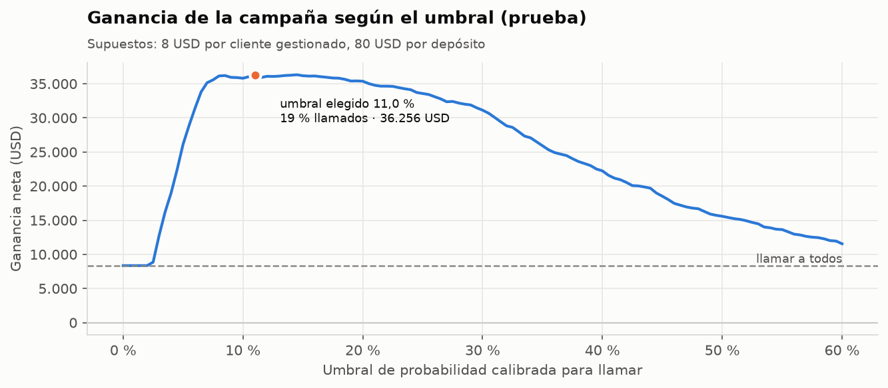
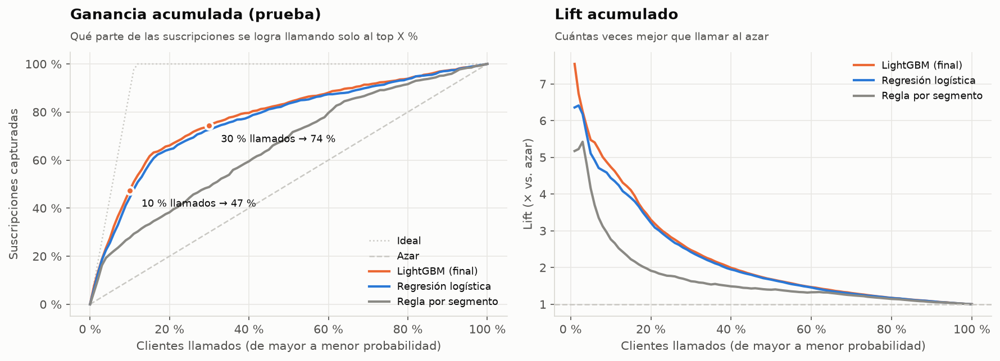
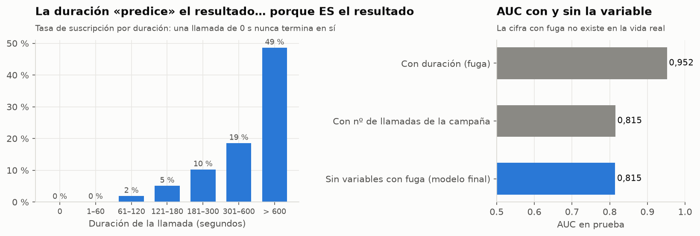
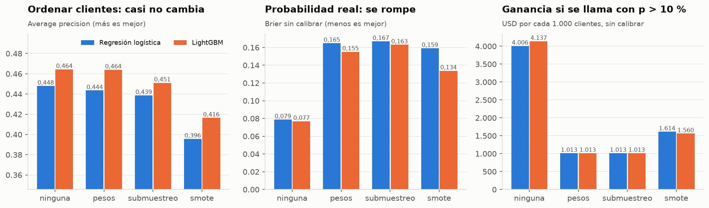
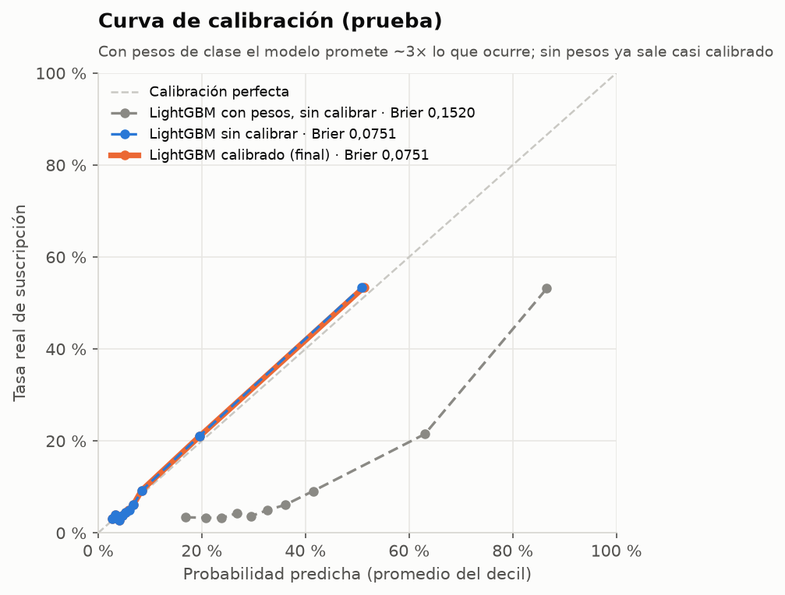
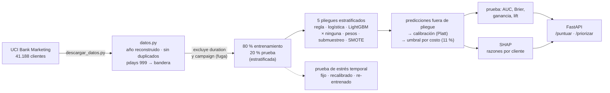
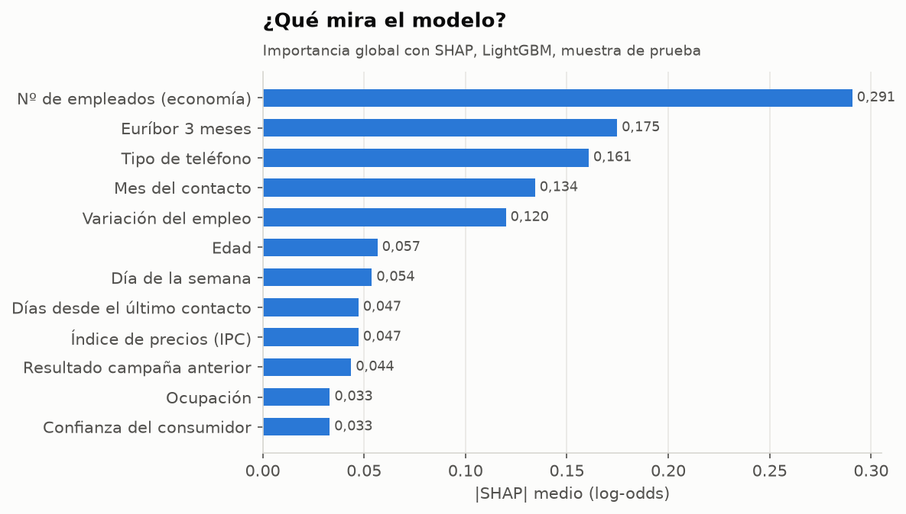
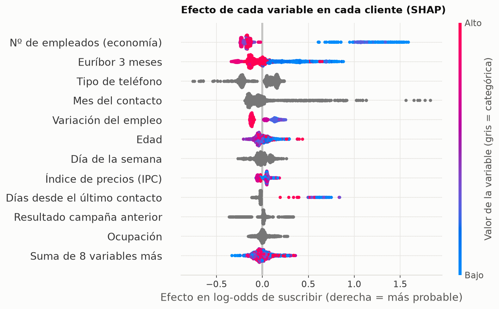
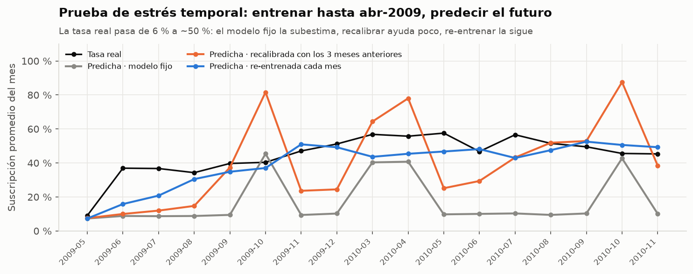

# 📞 ¿A quién llamar? Campaña de depósitos a plazo con ML

Modelo que decide **a qué clientes debe llamar un banco** para ofrecer un depósito a plazo, con la probabilidad **calibrada** de que acepten y un **umbral elegido por costo/beneficio** de cada llamada. Datos reales de telemercadeo de un banco portugués (UCI Bank Marketing, **41 mil clientes**, 2008–2010, solo 11 % acepta). Incluye el tratamiento de la **fuga de información** de `duration`, la comparación **pesos vs. remuestreo** para el desbalance, **SHAP**, una **prueba de estrés temporal** y una **API FastAPI**.


> ⚠️ **Antes de leer las cifras:** todos los resultados de abajo usan una partición **estratificada** 80/20, que es **optimista** para este problema. Cuando se hace la prueba que sí imita el uso real (entrenar con el pasado y predecir el futuro, [prueba de estrés temporal](#-prueba-de-estrés-temporal)), el AUC cae de **0,815** a **0,704**, el modelo predice en promedio **11,7 %** cuando la tasa real es **25,4 %**, y solo re-entrenarlo cada mes lo recupera (AUC 0,789). El modelo sirve para ordenar llamadas dentro de un régimen estable; para usarlo en otro periodo hay que re-entrenar y vigilar la deriva.

---

## 📌 El problema

Un banco llama por teléfono a sus clientes para venderles un depósito a plazo. Cada cliente gestionado cuesta tiempo de agente y telefonía, y **solo 1 de cada 9 acepta**. Llamar a todos casi no deja ganancia; no llamar a nadie deja dinero sobre la mesa. La pregunta no es «¿quién va a aceptar?» sino **«¿a quién conviene llamar, dado lo que cuesta una llamada y lo que deja un depósito?»**.

Eso exige tres cosas que un clasificador «de tutorial» no tiene:
1. **No hacer trampa:** la variable más predictiva del dataset (`duration`, duración de la llamada) **solo se conoce después de llamar**.
2. **Probabilidades reales** (calibradas), no solo un orden, para poder compararlas con el costo.
3. **Un umbral económico**, no el 0,5 por defecto.

## 🏆 Resultados (prueba: 8.236 clientes nunca vistos, partición estratificada)

| | Regla por segmento<br/>(tabla dinámica) | Regresión logística | **LightGBM calibrado** |
|---|---:|---:|---:|
| AUC | 0,675 | 0,801 | **0,815** |
| Average precision (tasa base 0,113) | 0,246 | 0,444 | **0,490** |
| Brier (menos es mejor) | 0,0898 | 0,0785 | **0,0751** |
| Brier skill vs. tasa base | 0,10 | 0,22 | **0,25** |
| Suscripciones capturadas llamando al top 10 % | 27,7 % | 44,4 % | **47,4 %** (lift 4,7×) |

**¿Cuánto del orden entre modelos es azar?** Intervalos de confianza al 95 % por *bootstrap pareado* (2.000 remuestras de los 8.236 clientes de prueba; cada remuestra se evalúa con los tres modelos), en [`reports/bootstrap_metricas_prueba.csv`](reports/bootstrap_metricas_prueba.csv):

| Métrica (prueba) | Regla por segmento | Regresión logística | **LightGBM calibrado** | **LightGBM − logística** |
|---|---:|---:|---:|---:|
| AUC | 0,675 [0,658; 0,693] | 0,801 [0,784; 0,818] | **0,815** [0,798; 0,832] | **+0,014** [+0,008; +0,020] |
| Average precision | 0,246 [0,221; 0,271] | 0,444 [0,408; 0,480] | **0,490** [0,455; 0,525] | **+0,046** [+0,033; +0,059] |
| Brier (menos es mejor) | 0,0898 [0,0850; 0,0946] | 0,0785 [0,0740; 0,0827] | **0,0751** [0,0706; 0,0793] | **−0,0034** [−0,0044; −0,0025] |

LightGBM le gana a la regresión logística en las tres métricas y ningún intervalo de la diferencia incluye el cero, pero la ventaja es **pequeña** (0,014 de AUC): una logística bien armada sería una alternativa defendible si se priorizara la simplicidad. Frente a la regla por segmento la diferencia es grande (AUC +0,139 [+0,124; +0,154]). Estos intervalos miden solo el azar de muestrear 8.236 clientes: **no** incluyen el cambio de régimen de la prueba de estrés temporal.

**En dinero** (supuestos: 8 USD por cliente gestionado, 80 USD de margen por depósito → umbral 11 %):

| Política en prueba | Llamados | Depósitos capturados | Conversión | Ganancia neta |
|---|---:|---:|---:|---:|
| Llamar a todos | 100 % | 100 % | 11,3 % | 8.352 USD |
| Regla: segmentos con tasa > 10 % | 64,1 % | 84,5 % | 14,9 % | 20.488 USD |
| Logística calibrada, p ≥ 11 % | 20,7 % | 64,8 % | 35,2 % | 34.440 USD |
| **LightGBM calibrado, p ≥ 11 %** | **18,8 %** | **65,5 %** | **39,3 %** | **36.256 USD (×4,3)** |
| Oráculo (techo teórico) | 11,3 % | 100 % | 100 % | 66.816 USD |

👉 **Llamando a menos de 1 de cada 5 clientes se consigue 2 de cada 3 depósitos**, y la ganancia de la campaña se multiplica por 4,3 frente a llamar a todos.

| | |
|---|---|
|  |  |

## 🚫 La fuga de información: `duration`

`duration` es la duración de la última llamada. **Se conoce cuando la llamada terminó**: una llamada de 0 segundos nunca acaba en «sí» y las de más de 10 minutos aceptan el 49 %. Con ella el AUC sube a **0,952**, la cifra que aparece en muchos tutoriales… y que **no existe en la vida real**, porque al decidir a quién llamar la duración no se conoce.



| Variante (LightGBM, prueba) | AUC | Average precision |
|---|---:|---:|
| Con `duration` (fuga) | 0,952 | 0,673 |
| Con `campaign` (nº de llamadas de esta campaña) | 0,815 | 0,495 |
| **Sin variables con fuga (modelo final)** | **0,815** | **0,490** |

También se excluye **`campaign`**, una fuga más sutil: cuenta las llamadas de esta campaña *incluida la última*, y el banco deja de llamar cuando el cliente acepta, así que depende del resultado (y antes de empezar no se sabe cuántas hará falta). Aporta casi nada, pero por principio no entra. Hay una prueba automática que verifica que ninguna variable con fuga llegue al modelo.

## ⚖️ Desbalance: pesos vs. remuestreo

2 modelos × 4 estrategias, con 5 pliegues estratificados (el remuestreo se aplica **solo** al pliegue de ajuste; la validación conserva la proporción real):



| LightGBM (fuera de pliegue) | Average precision | Brier sin calibrar | Prob. media predicha | Brier calibrado |
|---|---:|---:|---:|---:|
| **Sin ajuste** | **0,464** | **0,077** | 11,3 % ✓ | **0,077** |
| Pesos balanceados | 0,464 | 0,155 | 37,7 % ✗ | 0,077 |
| Submuestreo aleatorio | 0,451 | 0,163 | 38,8 % ✗ | 0,078 |
| SMOTE-NC | 0,416 | 0,134 | 31,1 % ✗ | 0,081 |

- Pesos y remuestreo **no mejoran el orden** (AP igual o peor; SMOTE inventa clientes interpolando y empeora).
- **Sí destruyen la probabilidad:** el modelo cree que acepta el 38 % cuando acepta el 11 %. Con la regla «llamar si p > 10 %» se termina llamando a todos y la ganancia cae de ~4.100 a ~1.000 USD por cada 1.000 clientes.
- **Conclusión:** el desbalance no se arregla remuestreando, se arregla con **probabilidades calibradas + umbral económico**. El modelo final es LightGBM sin ajuste, elegido por la ganancia calibrada fuera de pliegue.

## 🎯 Calibración y umbral



- Se compararon Platt e isotónica **con validación cruzada sobre las predicciones fuera de pliegue** (ningún cliente calibra su propia predicción). LightGBM sin pesos ya sale casi calibrado (Brier 0,07695 → 0,07695 con Platt); con pesos, la calibración baja el Brier de 0,155 a 0,077.
- **Umbral teórico:** con p calibrada, llamar conviene si `p × 80 − 8 > 0` ⇔ **p > 10 %**. El umbral que maximiza la ganancia fuera de pliegue es **11 %**: casi el mismo, otra señal de que las probabilidades son reales.
- **Si cambian los costos no hay que re-entrenar:** el umbral pasa a ser `costo / beneficio` ([sensibilidad](reports/sensibilidad_costos.csv)). La API acepta costos propios por petición.

| Costo por cliente → / Margen por depósito ↓ | 4 USD | 8 USD | 16 USD |
|---|---:|---:|---:|
| **40 USD** | +13,7 k | +41,7 k | +99,0 k |
| **80 USD** | +4,2 k | **+27,5 k** | +83,4 k |
| **160 USD** | −0,2 k | +8,5 k | +54,9 k |

*Mejora en USD del modelo frente a llamar a todos, en prueba.* Solo cuando la llamada es baratísima frente al margen (umbral 2,5 %) conviene llamar a casi todos y el modelo no agrega valor.

## 🧠 Cómo funciona



| Decisión | Por qué |
|---|---|
| **Excluir `duration` y `campaign`** | Solo se conocen después (o durante) la campaña: fuga de información |
| **Partición estratificada 80/20 + 5 pliegues** como evaluación principal | El 70 % de los datos son de 2008 y el «futuro» (2009-05 → 2010-11) es otro régimen (25 % de éxito vs. 6 %). Una partición temporal mediría sobre todo el cambio de régimen; por eso se hace **aparte, como prueba de estrés** |
| **Todas las decisiones con validación cruzada** | Modelo, estrategia de desbalance, calibrador y umbral se eligen fuera de pliegue; la prueba se mira una sola vez |
| **Línea base de negocio** (tasa por segmento) | Lo que haría un analista con una tabla dinámica; el modelo tiene que ganarle |
| **Sin pesos de clase** | Igual orden, probabilidades reales (ver arriba) |
| **Umbral = costo / beneficio** | Convierte la probabilidad en una decisión con dinero; con capacidad limitada se usa el ranking (lift) |
| **TreeSHAP nativo** (`pred_contrib=True`) | Exacto, rápido y compatible con las categóricas nativas de LightGBM |

## 🔍 ¿Qué mira el modelo?

| Importancia global | Efecto por cliente |
|---|---|
|  |  |

- **La economía manda:** con pocos empleados en la economía y euríbor bajo (2009–2010) la probabilidad sube mucho.
- **Celular** mejor que teléfono fijo; clientes **contactados hace pocos días** en una campaña anterior (sobre todo si aceptaron) responden mucho mejor.
- **Cuidado con el mes:** marzo, septiembre, octubre y diciembre parecen «buenos meses», pero en gran parte es el régimen (esos meses casi solo existen en 2009–2010). Lo explico en el [notebook 3](notebooks/03_umbral_ganancia_shap_api.ipynb).

## ⏳ Prueba de estrés temporal

Entrenar con todo lo anterior a mayo 2009 (30.421 clientes, 6,3 % de éxito) y predecir mayo 2009 → noviembre 2010 (10.755 clientes, **25,4 %** de éxito):

| Operación | AUC | Brier | Llamados | Ganancia |
|---|---:|---:|---:|---:|
| Modelo fijo | 0,704 | 0,195 | 21 % | 80.120 USD |
| Recalibrar el intercepto cada mes (3 meses previos) | 0,704 | 0,173 | 41 % | 126.496 USD |
| **Re-entrenar cada mes** (ventana creciente) | **0,789** | **0,149** | 46 % | **137.112 USD** |
| Llamar a todos | — | — | 100 % | 132.520 USD |



**Lectura honesta:** ante un cambio de régimen así, el modelo fijo subestima la tasa (predice en promedio 11,7 % cuando la tasa real es 25,4 %) y deja 52 mil USD sobre la mesa; recalibrar ayuda pero no alcanza, porque el efecto «mes» aprendido en 2008 hace saltar las predicciones. **Re-entrenar cada mes** (cuesta segundos) es la única opción que supera a «llamar a todos». **Recomendación:** re-entrenar mensualmente y vigilar tasa real vs. predicha como alerta de deriva. Ficha completa: **[MODEL_CARD.md](MODEL_CARD.md)**.

## 🔌 API

```bash
uvicorn api.main:app --reload          # documentación interactiva en http://localhost:8000/docs
```

```bash
curl -X POST http://localhost:8000/puntuar -H "Content-Type: application/json" -d '{
  "edad": 35, "ocupacion": "admin.", "estado_civil": "single", "educacion": "university.degree",
  "hipoteca": "yes", "tipo_contacto": "cellular", "mes": "may", "dia_semana": "thu",
  "dias_desde_contacto": 6, "contactos_previos": 2, "resultado_previo": "success",
  "var_empleo": -1.8, "ipc": 92.893, "confianza_consumidor": -46.2, "euribor_3m": 1.299, "num_empleados": 5099.1 }'
```

```json
{
  "probabilidad": 0.3256,
  "llamar": true,
  "umbral": 0.11,
  "valor_esperado_usd": 18.05,
  "razones": [
    {"variable": "dias_desde_contacto", "factor": "Días desde el último contacto", "valor": "6", "efecto_log_odds": 0.9356, "sentido": "sube la probabilidad"},
    {"variable": "contactado_antes", "factor": "Contactado antes", "valor": "1", "efecto_log_odds": 0.2627, "sentido": "sube la probabilidad"},
    {"variable": "euribor_3m", "factor": "Euríbor 3 meses", "valor": "1.299", "efecto_log_odds": 0.2332, "sentido": "sube la probabilidad"}
  ]
}
```

| Endpoint | Qué hace |
|---|---|
| `GET /salud` | estado del servicio |
| `GET /modelo` | versión, supuestos, umbral, variables excluidas por fuga y métricas de prueba |
| `POST /puntuar` | un cliente → probabilidad calibrada, ¿llamar?, valor esperado y 3 razones SHAP (validación pydantic de cada campo) |
| `POST /priorizar?capacidad=…&costo_llamada=…&beneficio_exito=…` | hasta 10.000 clientes ordenados de mayor a menor probabilidad; respeta la capacidad del call center y acepta costos propios (umbral = costo/beneficio) |

## 📓 Notebooks (ejecutados, con resultados)

1. [Datos, fuga y validación](notebooks/01_datos_y_fuga.ipynb): desbalance, régimen económico 2008–2010, `duration` y `campaign`, por qué estratificada + estrés temporal
2. [Modelos, desbalance y calibración](notebooks/02_modelos_desbalance_calibracion.ipynb): 2 modelos × 4 estrategias, Platt vs. isotónica, métricas de prueba
3. [Umbral, ganancia, SHAP y API](notebooks/03_umbral_ganancia_shap_api.ipynb): ganancia por umbral, sensibilidad, lift por deciles, SHAP global y local, prueba temporal, uso de la API

## 🚀 Cómo ejecutarlo

Guía detallada para Windows: **[docs/GUIA_PASO_A_PASO.md](docs/GUIA_PASO_A_PASO.md)**

```bash
python -m venv .venv && .venv\Scripts\activate
pip install -r requirements.txt
pip install -e .
pytest                                   # 30 pruebas (la API funciona con el modelo incluido)
uvicorn api.main:app --reload            # API
python descargar_datos.py                # (para re-entrenar) baja el CSV de UCI a data/raw/ (1 MB)
python -m campana.entrenar               # (opcional) entrenamiento y evaluación completos: ~4 min
```

El modelo entrenado viene en `models/` (150 KB), así que la API y sus pruebas funcionan **sin descargar los datos**.

## 📁 Estructura

```
├── descargar_datos.py     baja bank-additional-full.csv desde UCI
├── src/campana/
│   ├── config.py          rutas, variables, variables con fuga, supuestos de costo/beneficio
│   ├── datos.py           lectura, año reconstruido, pdays, particiones estratificada y temporal
│   ├── modelos.py         regla base, logística, LightGBM, remuestreo (submuestreo/SMOTE-NC), calibrador
│   ├── evaluacion.py      métricas, fuera de pliegue, ganancia, umbral, lift, deciles
│   ├── explicar.py        SHAP global y razones por cliente
│   ├── graficos.py        8 figuras
│   ├── entrenar.py        todo el pipeline en un comando
│   └── predecir.py        puntuador usado por la API
├── api/main.py            FastAPI
├── models/                modelo + calibrador + umbral (joblib) y metadata.json
├── notebooks/             3 notebooks ejecutados
├── reports/               figuras y tablas (comparación, políticas, deciles, sensibilidad, temporal)
├── tests/                 30 pruebas: datos, métricas a mano, bootstrap, modelos con datos sintéticos, API
└── MODEL_CARD.md          ficha del modelo
```

## 📚 Fuente de datos

**Bank Marketing** — S. Moro, P. Rita y P. Cortez (2014), UCI Machine Learning Repository: <https://archive.ics.uci.edu/dataset/222/bank+marketing> · DOI [10.24432/C5K306](https://doi.org/10.24432/C5K306). Archivo `bank-additional-full.csv` (41.188 filas, 20 variables + objetivo), campañas de telemercadeo de un banco portugués, mayo 2008 – noviembre 2010. Licencia **CC BY 4.0**.

Referencia: Moro, Cortez y Rita (2014). *A Data-Driven Approach to Predict the Success of Bank Telemarketing.* Decision Support Systems 62, 22–31.

Los datos no se versionan; `descargar_datos.py` los baja del sitio oficial.

**Licencia:** el **código** de este repositorio es MIT (ver [LICENSE](LICENSE)). Los **datos** siguen su propia licencia, CC BY 4.0 (UCI Bank Marketing, Moro, Rita y Cortez).

---

**Erick Guarnizo** · proyecto de portafolio (Machine Learning)
