# 💎 ¿Quién sigue vivo y cuánto vale? CLV y retención en retail (BG/NBD + Gamma-Gamma)

Sistema probabilístico que estima **qué clientes siguen activos**, **cuántas veces comprarán**, **cuál será su ticket medio** y **a quién conviene rescatar** en un comercio minorista donde el abandono ocurre en silencio. Evaluado sobre **UCI Online Retail II** (**1,07 millones de líneas**, 2009–2011, tienda británica de regalos y hogar) con una partición temporal estricta (**18 meses de calibración → 6 meses de prueba nunca vistos**). Incluye auditoría de limpieza contable, formulación exacta por máxima verosimilitud de **BG/NBD** y **Gamma-Gamma** (Fader, Hardie & Lee, 2005), comparación con **heurísticas RFM** y **LightGBM supervisado** (con intervalos bootstrap), **validación de las campañas de rescate con el gasto real del periodo de prueba**, una **API FastAPI** y una **app Streamlit**.


---

## 📌 El problema

En el comercio minorista sin suscripción (*non-contractual retail*), **los clientes no avisan cuando se van**: simplemente dejan de comprar. Eso plantea tres trampas que una tabla RFM tradicional o una extrapolación de promedios no resuelven:

1. **Abandono silencioso vs. ciclo largo:** un cliente que lleva 5 meses sin comprar puede haberse ido para siempre o puede ser un comprador estacional activo.
2. **La paradoja del comprador frecuente:** a igual tiempo sin comprar, quien compraba todos los meses y se calló de golpe tiene **mucha menor probabilidad de seguir vivo** que quien compraba cada medio año.
3. **Tickets extremos con pocas compras:** un cliente que hizo una sola compra de 900 GBP no necesariamente gastará 900 GBP siempre; hace falta **contracción empírica de Bayes (*shrinkage*)** hacia la media poblacional.

---

## 🏆 Resultados (prueba: 4.944 clientes en los 6 meses siguientes, `2011-06-10 → 2011-12-09`)

| Métrica en prueba (183 días nunca vistos) | Ritmo histórico<br/>(heurística) | Tabla RFM<br/>por tramos | LightGBM supervisado<br/>(Hurdle) | **BG/NBD +<br/>Gamma-Gamma** |
|---|---:|---:|---:|---:|
| AUC de la probabilidad de recompra en 6 meses | 0,762 | 0,774 | 0,800 | **0,810** |
| Brier de la probabilidad de recompra (menos es mejor) | 0,2178 | 0,2006 | 0,1897 | **0,1774** |
| MAE de compras (días con pedido) | 1,064 | 1,191 | 1,097 | **1,045** |
| RMSE de compras | 1,861 | 2,742 | 2,074 | **1,784** |
| Sesgo del conteo total de cartera | −3,2 % | −21,8 % | −26,9 % | **−1,4 %** |
| Correlación de Spearman (compras) | 0,591 | 0,566 | 0,607 | **0,624** |
| Correlación de Spearman (ingreso GBP) | 0,608 | 0,546 | 0,603 | **0,636** |
| Error agregado de ingreso de cartera | −12,4 % | −23,8 % | −40,9 % | **−10,0 %** |
| Ingreso futuro capturado en el **Top 10 %** | 55,2 % | 51,0 % | 56,5 % | **57,1 % (lift 5,7×)** |
| Ingreso futuro capturado en el **Top 20 %** | 70,7 % | 64,6 % | 71,6 % | **72,0 % (lift 3,6×)** |

*Qué se mide:* $P(\text{vivo})$ no es observable (nadie avisa cuando se va), así que el AUC y el Brier se calculan sobre **$P(Y(6\text{ m}) \ge 1)$, la probabilidad de volver a comprar en el semestre de prueba**, frente a si el cliente compró o no.

*Cómo se entrenaron las líneas base:* LightGBM y la tabla RFM necesitan etiquetas, así que se entrenan en una **ventana anterior** (corte `2010-12-09`, objetivo diciembre 2010 → junio 2011) y se aplican al corte de 2011. Ese semestre objetivo no incluye la temporada navideña (junio–noviembre de 2011 facturó 1,52 veces lo de diciembre 2010–mayo 2011), lo que explica la mayor parte de su sesgo de −40,9 % en ingreso. Probé también LightGBM con la **misma estación** que la prueba (corte `2010-06-09`, objetivo junio → diciembre 2010): el sesgo se invierte (+100,5 %) y empeora (AUC 0,774, Brier 0,2580), porque solo tiene 190 días de historia para construir variables ([`reports/lightgbm_ventanas.csv`](reports/lightgbm_ventanas.csv)). BG/NBD no necesita etiquetas y usa toda la historia hasta el corte.

**¿La ventaja sobre LightGBM es significativa?** Bootstrap pareado (1.000 remuestreos de clientes, los mismos para ambos modelos), diferencia BG/NBD + GG − LightGBM con IC 95 %:

| Métrica | BG/NBD + GG | LightGBM | Diferencia | IC 95 % | ¿Significativa? |
|---|---:|---:|---:|---:|:---:|
| AUC de recompra | 0,810 | 0,800 | +0,010 | [+0,004; +0,017] | Sí |
| Brier de recompra | 0,1774 | 0,1897 | −0,0124 | [−0,0158; −0,0086] | Sí |
| Spearman (compras) | 0,624 | 0,607 | +0,018 | [+0,008; +0,029] | Sí |
| Spearman (ingreso) | 0,636 | 0,603 | +0,033 | [+0,021; +0,046] | Sí |
| Captura del Top 20 % | 72,0 % | 71,6 % | +0,4 pp | [−0,6; +1,2] pp | **No** |

👉 BG/NBD + Gamma-Gamma ordena y calibra mejor que LightGBM con diferencias **pequeñas pero significativas**, y su ingreso de cartera es mucho más preciso (−10,0 % frente a −40,9 %). Para elegir **a quién priorizar** (Top 20 %), los dos modelos son equivalentes: el Top 20 % de BG/NBD concentra el **72,0 %** del ingreso futuro.

| | |
|---|---|
| 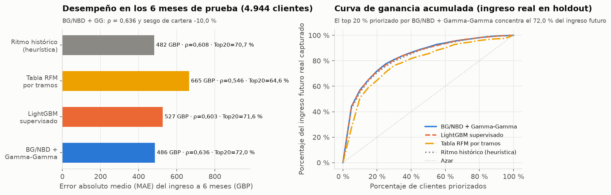 | 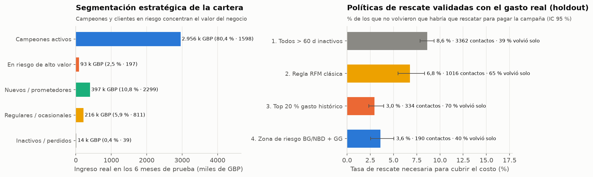 |

---

## 💸 Campañas de rescate: validadas con el gasto real del periodo de prueba

En los datos **no hubo ninguna campaña**, así que no se puede medir su efecto causal (haría falta un experimento A/B). Lo que sí se puede validar con el holdout es **a quién elige cada política** y **cuánto tendría que funcionar para pagarse**: para cada política, qué parte de los contactados volvió por su cuenta y cuánto margen generaban por semestre los que **no** volvieron (gasto observado antes del corte, no una predicción). Supuestos: `6,00 GBP` por contacto y `30 %` de margen bruto.

| Política (solo usa información hasta el corte) | Contactados | Costo | Volvió solo (sin campaña) | Margen real por contacto en la prueba | **Rescate necesario para cubrir el costo** (IC 95 %) |
|---|---:|---:|---:|---:|---:|
| 1. Todos con > 60 días sin comprar | 3.362 (68,0 %) | 20.172 GBP | 39,1 % | 87,18 GBP | 8,6 % [7,9; 9,4] |
| 2. Regla RFM clásica ($x \ge 2$ e inactividad 60–240 d) | 1.016 (20,6 %) | 6.096 GBP | 64,7 % | 183,33 GBP | 6,8 % [5,5; 8,3] |
| 3. Top 20 % gasto histórico con > 60 d sin comprar | 334 (6,8 %) | 2.004 GBP | 69,8 % | 351,79 GBP | **3,0 %** [2,3; 3,9] |
| 4. BG/NBD + GG: zona de riesgo con beneficio esperado > costo | 190 (3,8 %) | 1.140 GBP | 40,0 % | 144,66 GBP | **3,6 %** [2,5; 5,0] |

*Rescate necesario:* qué % de los contactados que **no** volvieron habría que recuperar (a su ritmo de gasto histórico) para pagar la campaña. Menos es mejor.

👉 **Lo que dicen los datos:**
- Las políticas 3 y 4 son las más eficientes y sus intervalos **se solapan**: con estos datos **no se puede afirmar que la política de BG/NBD supere a la heurística de gasto histórico**. Ambas necesitan menos de la mitad de rescate que contactar a todos los inactivos (8,6 %).
- Se diferencian en a quién eligen: el **69,8 %** de los elegidos por la política 3 volvió sin campaña (riesgo de regalar el incentivo a quien iba a comprar igual), frente al **40,0 %** de la política 4, que sí elige clientes en riesgo. Decidir entre ambas exige un experimento A/B.
- La política 4 contacta a **190 de los 197 clientes** del segmento «En riesgo de alto valor» (la misma zona de riesgo, $0,20 \le P(\text{vivo}) < 0,70$ y $x \ge 2$, se usa en la segmentación, en la política y en la API).

**Escenario con supuestos (no validado).** Los datos no traen ninguna campaña, así que el ROI en dinero no se puede medir: calcularlo con el margen que predice el propio modelo sería **circular** (la política 4 se elige con la misma fórmula con la que se mediría). Por eso se reporta solo como escenario, con su sensibilidad a la efectividad supuesta del rescate ([`reports/politicas_sensibilidad.csv`](reports/politicas_sensibilidad.csv)):

| ROI del escenario (efecto fuera de la zona de riesgo: 4 %) | Efectividad 5 % | 10 % | 25 % | 40 % |
|---|---:|---:|---:|---:|
| 1. Todos con > 60 días sin comprar | −85,2 % | −78,4 % | −58,1 % | −37,8 % |
| 2. Regla RFM clásica | −69,0 % | −55,1 % | −13,4 % | +28,3 % |
| 3. Top 20 % gasto histórico | −23,5 % | +14,6 % | +128,9 % | +243,2 % |
| 4. BG/NBD + GG (zona de riesgo) | +6,1 % | +112,1 % | +430,3 % | +748,5 % |

El ROI del escenario depende casi por completo de la efectividad supuesta; lo único robusto es que **contactar a todos los inactivos pierde dinero** con cualquier supuesto probado.

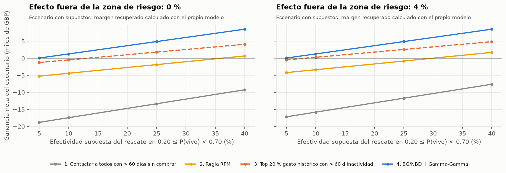

---

## 🧹 Auditoría de limpieza y corte temporal

Antes de ajustar cualquier distribución probabilística, auditamos las **1.067.371 filas** de las dos hojas de UCI Online Retail II (`2009-12-01` a `2011-12-09`):

| Etapa de limpieza contable | Filas | % del total | Importe (GBP) | Motivo técnico |
|---|---:|---:|---:|---|
| 0. Filas crudas totales | 1.067.371 | 100,0 % | 19.287.251 | Dos hojas anuales completas |
| 1. Sin `Customer ID` (invitado) | 243.007 | 22,8 % | 2.638.958 | No se puede rastrear la trayectoria individual |
| 2. Cancelaciones (`Invoice` empieza con `C`) | 18.744 | 1,8 % | −1.095.137 | Notas de crédito y anulaciones |
| 3. Códigos contables/envío (`POST`, `M`, `DOT`...) | 2.925 | 0,3 % | 308.964 | Portes, comisiones bancarias y ajustes manuales |
| 4. Precio o cantidad $\le 0$ | 61 | 0,01 % | 0 | Registros de merma o ajuste sin valor comercial |
| 5. Duplicados exactos de línea | 26.055 | 2,4 % | 365.882 | Doble registro del mismo ítem en la misma factura |
| **6. Líneas limpias retenidas** | **776.579** | **72,8 %** | **17.068.583** | Consolidadas en **32.878 días de compra** |

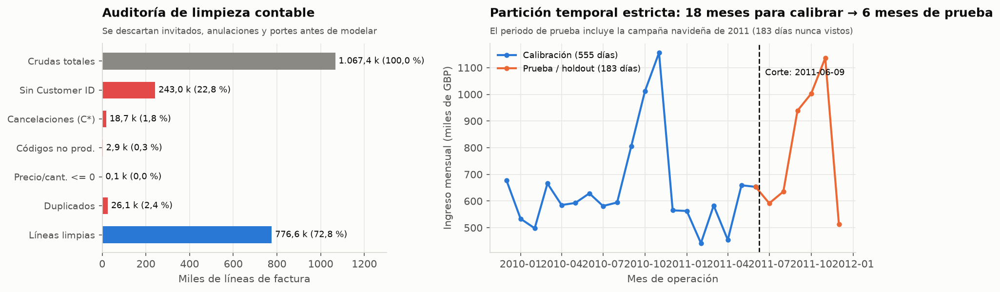

- **Consolidación diaria:** si un cliente emite 2 facturas el mismo día con minutos de diferencia, en BG/NBD cuenta como **1 evento diario de compra** con la suma del importe del día.
- **Supuesto de Gamma-Gamma (independencia entre frecuencia $x$ y ticket medio $m_x$): se cumple solo de forma aproximada.** Unos pocos mayoristas tienen pedidos de hasta `38.663 GBP`; tras acotar el ticket diario en el percentil 99,5 (`3.000 GBP`), la correlación **lineal** es débil (Pearson $r = 0,159$), pero la correlación **de rangos** es $\rho = 0,249$ (Spearman, $p \approx 3 \times 10^{-48}$) y no cambia al acotar ni al excluir mayoristas ($\rho = 0,249$–$0,250$): los clientes más frecuentes tienden a tener tickets algo mayores. Efecto práctico: el modelo contrae de más el ticket de los clientes muy frecuentes, lo que contribuye a que subestime su ingreso (ver limitaciones).

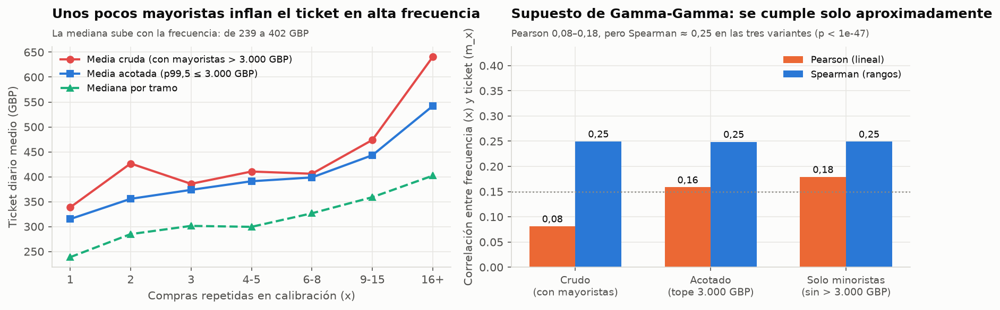

---

## 📐 Modelos probabilísticos: BG/NBD + Gamma-Gamma

### 1. Conteo y supervivencia: BG/NBD
Ajustado por máxima verosimilitud sobre los **4.944 clientes** activos hasta el `2011-06-09` ($x, t_x, T$ en semanas):

| Parámetro | Valor estimado | Interpretación en el negocio |
|---|---:|---|
| $r$ (forma de $\lambda$) | **0,6830** | Alta heterogeneidad en el ritmo de compra entre clientes ($r < 1$) |
| $\alpha$ (escala de $\lambda$, semanas) | **9,4806** | Tasa media poblacional $\mathbb{E}[\lambda] = r/\alpha = 0,072\text{ compras/semana}$ ($\approx 3,7\text{ al año}$) |
| $a$ (forma Beta de baja $p$) | **0,1518** | Probabilidad de baja tras cada compra muy asimétrica hacia valores bajos |
| $b$ (escala Beta de baja $p$) | **3,3057** | Probabilidad media de abandono tras una compra $\mathbb{E}[p] = a/(a+b) = \mathbf{4,39\%}$ |

| Ajuste de frecuencias y pronóstico | Superficie $P(\text{vivo})$ y paradoja de alta frecuencia |
|---|---|
| 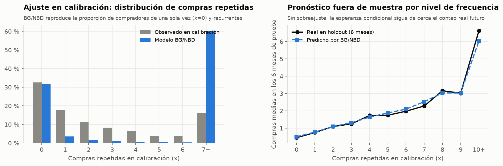 | 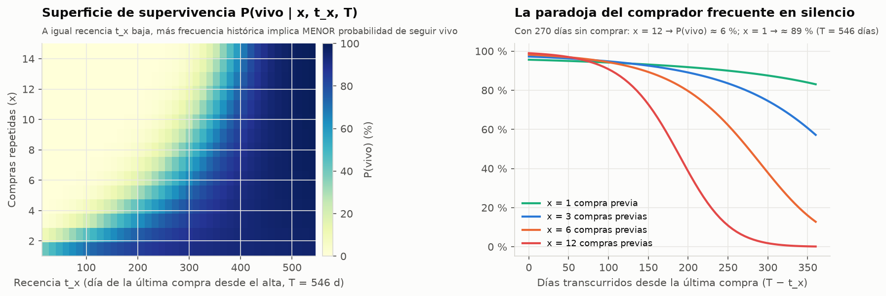 |

- **La paradoja del comprador frecuente en silencio:** con 546 días de antigüedad y **270 días sin comprar**, un cliente con $x = 12$ compras cae a $P(\text{vivo}) \approx 6\%$, mientras que uno con $x = 1$ mantiene $P(\text{vivo}) \approx 89\%$ (a los 180 días: 53 % frente a 92 %). Los datos de la prueba lo confirman: con más de 180 días sin comprar, los clientes con $x \ge 7$ volvieron menos que los de $x$ = 3–6 (notebook 1).
- **$P(\text{vivo en } T)$ vs. $P(\text{recomprar en 6 meses})$:** en BG/NBD la baja ocurre después de una compra, por lo que $P(\text{vivo en } T \mid x=0) = 1$. Para evaluar y calibrar la probabilidad real de que un cliente compre en el semestre siguiente calculamos la solución exacta:
  $$P(Y(t) \ge 1 \mid x, t_x, T) = P(\text{vivo} \mid x, t_x, T) \cdot \left[1 - \left(\frac{\alpha + T}{\alpha + T + t}\right)^{r + x}\right]$$

### 2. Valor monetario y *shrinkage* bayesiano: Gamma-Gamma
Ajustado sobre los **3.336 clientes con compras repetidas** ($x \ge 1$):
- Parámetros: **$p = 2,2995$**, **$q = 3,8383$**, **$\gamma = 484,87$** $\implies$ ticket diario medio poblacional **$\mu_0 = 392,81\text{ GBP}$**.
- Con $x = 1$ compra repetida, el modelo da un peso de **44,8 %** al promedio del cliente y **55,2 %** a la media poblacional; con $x \ge 3$ compras, la historia propia del cliente ya pesa **más del 70 %**.

| Calibración por deciles | Contracción empírica de Bayes (*shrinkage*) |
|---|---|
| 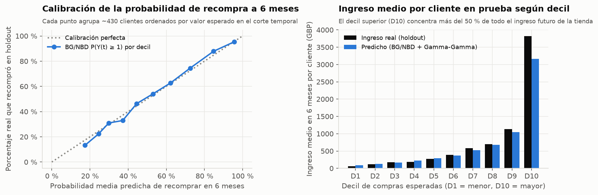 | 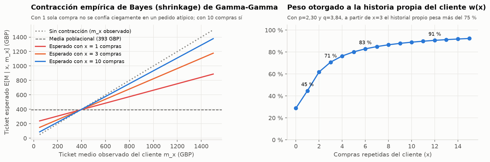 |

---

## 🧭 Segmentación accionable de la cartera

Cruzando $P(\text{vivo})$, frecuencia histórica $x$ y CLV neto a 6 meses (margen 30 %, descuento 1 % mensual). Para comparar predicción y realidad con la misma vara, la recompra predicha es $P(Y(6\text{ m}) \ge 1)$:

| Segmento estratégico | Clientes | % cartera | $P(\text{vivo})$ media | Recompra predicha (6m) | Recompra real (6m) | CLV neto medio | Ingreso real 6m (GBP) | % del ingreso futuro | Acción recomendada |
|---|---:|---:|---:|---:|---:|---:|---:|---:|---|
| **Campeones activos** | 1.598 | 32,3 % | 95,0 % | 82,4 % | 84,9 % | 454,39 GBP | **2.955.955** | **80,4 %** | Fidelización VIP y acceso anticipado (sin descuento agresivo) |
| **En riesgo de alto valor** | 197 | 4,0 % | 51,8 % | 38,2 % | 40,6 % | 113,63 GBP | 92.641 | 2,5 % | **Campaña prioritaria de reactivación personalizada (rescate)** |
| **Nuevos / prometedores** | 2.299 | 46,5 % | 95,8 % | 32,9 % | 30,5 % | 58,39 GBP | 397.155 | 10,8 % | Secuencia de segunda compra (*cross-sell* a 30 días) |
| **Regulares / ocasionales** | 811 | 16,4 % | 85,4 % | 52,5 % | 52,7 % | 92,17 GBP | 216.035 | 5,9 % | Newsletter automatizada de bajo costo |
| **Inactivos / perdidos** | 39 | 0,8 % | 7,5 % | 6,2 % | 20,5 % | 26,77 GBP | 14.498 | 0,4 % | No invertir presupuesto directo (solo *retargeting* pasivo) |

---

## ⚠️ Limitaciones

1. **Sin experimento, no hay ROI validado.** El holdout valida a quién elige cada política y cuánto tendría que funcionar para pagarse, no el efecto causal de la campaña. El ROI del escenario depende casi por completo de la efectividad supuesta.
2. **«Inactivos / perdidos» se dan por muertos demasiado pronto.** Tienen $P(\text{vivo})$ media de 7,5 % (recompra predicha 6,2 %), pero el **20,5 %** volvió a comprar y gastaron **4,0 veces** lo esperado (14.498 frente a 3.603 GBP). Son 39 clientes muy frecuentes con un silencio largo, probablemente compradores estacionales que la tasa constante de BG/NBD no captura. En dinero pesa poco (0,4 % del ingreso), pero justifica mantener el *retargeting* pasivo en vez de excluirlos.
3. **Estacionalidad navideña.** BG/NBD supone una tasa de compra constante por cliente; el semestre de prueba incluye el pico de septiembre–noviembre y el modelo subestima el ingreso de cartera en −10,0 % (los Campeones gastaron 1,18 veces lo esperado).
4. **Gamma-Gamma se cumple solo aproximadamente** (Spearman $\rho = 0,249$ entre frecuencia y ticket), lo que también contribuye a subestimar a los clientes más frecuentes.
5. **Mayoristas:** los clientes con pedidos > 3.000 GBP se acotan para el modelo, pero en la práctica deberían gestionarse como cuentas clave B2B.

---

## 🧠 Arquitectura y decisiones técnicas

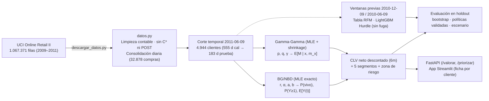

| Decisión técnica | Por qué |
|---|---|
| **Consolidación por día de compra** | Evita contar como «recompra» dos facturas emitidas con minutos de diferencia el mismo día |
| **Acotar el ticket diario en `3.000 GBP` (p99,5)** | Separa distribuidores mayoristas de hasta 38,7 k GBP que distorsionarían la escala $\gamma$ de Gamma-Gamma |
| **Implementación analítica propia en `scipy`** | Log-verosimilitud exacta con `gammaln`, `betaln` y continuación analítica de ${}_2F_1$ (verificada con cuadratura de Gauss-Legendre de 64 nodos), sin depender de paquetes archivados |
| **Exponer tanto $P(\text{vivo en } T)$ como $P(Y(t) \ge 1)$** | Resuelve la limitación clásica de $P(\text{vivo}\mid x=0)=1$ y ofrece una probabilidad de compra que sí se puede evaluar contra lo observado |
| **LightGBM entrenado en una ventana anterior** | Es la única forma de entrenar un modelo supervisado sin mirar el periodo de prueba; se compara además con la ventana de la misma estación |
| **Validar políticas con el gasto real y no con el modelo** | Evita el razonamiento circular de medir una política con la misma fórmula con la que se eligió |

---

## 🔌 API FastAPI

```bash
uvicorn api.main:app --reload          # documentación interactiva en http://localhost:8000/docs
```

```bash
curl -X POST http://localhost:8000/valorar -H "Content-Type: application/json" -d '{
  "id_cliente": "13093", "frecuencia": 6, "recencia_dias": 240, "edad_dias": 490, "ticket_medio": 520.0
}'
```

```json
{
  "prob_vivo": 0.5037,
  "prob_recompra": 0.4284,
  "compras_esperadas": 1.087,
  "ticket_esperado_gbp": 498.3,
  "ingreso_esperado_gbp": 541.56,
  "clv_neto_gbp": 156.96,
  "inactividad_dias": 250.0,
  "segmento": "En riesgo de alto valor",
  "accion_recomendada": "Campaña prioritaria de reactivación personalizada (rescate)",
  "conviene_contactar_rescate": true,
  "beneficio_neto_rescate_gbp": 34.02,
  "id_cliente": "13093"
}
```

`beneficio_neto_rescate_gbp` usa el supuesto de 25 % de efectividad (configurable en la petición): sirve para ordenar, no es una ganancia validada.

| Endpoint | Qué hace |
|---|---|
| `GET /salud` | Estado del servicio |
| `GET /modelo` | Parámetros estimados de BG/NBD y Gamma-Gamma, supuestos financieros y métricas en prueba |
| `POST /valorar` | Valora un cliente individual ($P(\text{vivo})$, $P(\text{recompra})$, compras, ticket con *shrinkage*, CLV neto, segmento y beneficio de rescate) con validación Pydantic ($T \ge t_x$) |
| `POST /priorizar?modo=clv\|rescate&capacidad=…` | Ordena una cartera de hasta 5.000 clientes por CLV neto o por beneficio esperado de reactivación respetando el cupo máximo |

---

## 🖥️ App Streamlit

```bash
streamlit run app/app.py --server.port 8615
```

Tres pestañas: **buscar un cliente** por su `Customer ID` y ver su CLV neto, $P(\text{vivo})$, probabilidad de recompra, segmento, acción recomendada y lo que realmente compró en la prueba; **simular** un cliente hipotético con el mismo motor que la API; y **cartera y políticas** (segmentos, políticas validadas y descarga de la lista de rescate). Usa el modelo guardado y [`reports/cartera_clientes.csv`](reports/cartera_clientes.csv), así que no necesita los datos crudos.

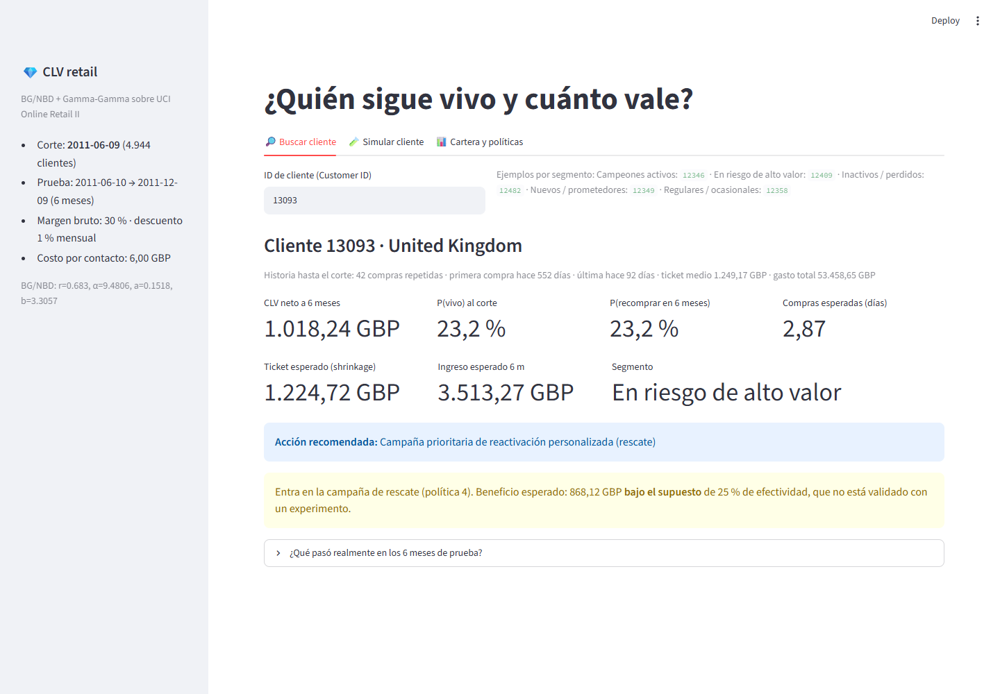

---

## 📓 Notebooks (ejecutados, con resultados)

1. [Datos, auditoría de limpieza y corte temporal](notebooks/01_datos_limpieza_y_corte_temporal.ipynb): reglas contables, consolidación diaria, estacionalidad mensual, distribuciones de la matriz BTYD, recompra real por frecuencia e inactividad y supuesto de Gamma-Gamma.
2. [BG/NBD, Gamma-Gamma y evaluación en prueba](notebooks/02_bgnbd_gamma_gamma_y_evaluacion.ipynb): parámetros MLE, tabla de la paradoja del comprador frecuente, calibración por deciles, *shrinkage*, bootstrap frente a LightGBM y comparación de ventanas de entrenamiento.
3. [Segmentación, políticas validadas y servicio](notebooks/03_segmentacion_retencion_y_api.ipynb): segmentos y dónde se equivoca el modelo, políticas de rescate validadas con el holdout, escenario y sensibilidad, API y app.

---

## 🚀 Cómo ejecutarlo

Guía detallada para Windows con preguntas de entrevista: **[docs/GUIA_PASO_A_PASO.md](docs/GUIA_PASO_A_PASO.md)** · Ficha técnica: **[MODEL_CARD.md](MODEL_CARD.md)**

```powershell
py -3.14 -m venv .venv
.venv\Scripts\activate
pip install -r requirements.txt
pip install -e .
pytest                                   # 31 pruebas automáticas
uvicorn api.main:app --reload            # API en http://localhost:8000/docs
streamlit run app/app.py                 # app en http://localhost:8501
python descargar_datos.py                # genera data/raw/online_retail_ii.csv
python -m clv.entrenar                   # re-entrena todo y regenera figuras y tablas (~20 s)
```

---

## 📁 Estructura

```text
├── descargar_datos.py     descarga/convierte UCI Online Retail II a data/raw/online_retail_ii.csv
├── src/clv/
│   ├── config.py          rutas, cortes temporales, zona de riesgo y supuestos de negocio
│   ├── datos.py           auditoría de limpieza, consolidación diaria y matriz BTYD (x, t_x, T, m_x)
│   ├── modelos.py         BG/NBD (MLE exacto + 2F1/cuadratura), Gamma-Gamma, heurísticas y LightGBM
│   ├── evaluacion.py      métricas en holdout, bootstrap pareado, calibración, supuesto GG y curvas de captura
│   ├── segmentacion.py    5 segmentos, políticas validadas con el holdout y escenario con sensibilidad
│   ├── graficos.py        9 figuras en reports/figures/
│   ├── entrenar.py        pipeline completo en un comando
│   └── predecir.py        motor de valoración usado por la API y la app
├── api/main.py            servicio FastAPI (/salud, /modelo, /valorar, /priorizar)
├── app/app.py             app Streamlit (ficha por cliente, simulador y cartera)
├── models/                modelo_clv.joblib y metadata.json
├── notebooks/             3 notebooks ejecutados
├── reports/               9 figuras + captura de la app, 14 tablas CSV y resultados.json
├── tests/                 31 pruebas (datos, matemática BTYD, evaluación, políticas, bootstrap, API y app)
├── MODEL_CARD.md          ficha técnica del modelo
└── docs/GUIA_PASO_A_PASO.md  guía de reproducción y preguntas de entrevista
```

---

## 📚 Fuente de datos y referencias

- **Online Retail II** — Daqing Chen, Sai Laing Sain y Kun Guo (2012), UCI Machine Learning Repository: <https://archive.ics.uci.edu/dataset/502/online+retail+ii> · DOI [10.24432/C5CG6D](https://doi.org/10.24432/C5CG6D). Licencia **CC BY 4.0**.
- **Licencia:** el **código** de este repositorio es MIT (ver [LICENSE](LICENSE)). Los **datos** (Online Retail II) siguen su propia licencia, CC BY 4.0, y no se versionan: `descargar_datos.py` los baja del sitio oficial.
- Fader, P. S., Hardie, B. G. S. y Lee, K. L. (2005). *“Counting Your Customers” the Easy Way: An Alternative to the Pareto/NBD Model.* Marketing Science, 24(2), 275–284.
- Fader, P. S., Hardie, B. G. S. y Lee, K. L. (2005). *RFM and CLV: Using Iso-Value Curves for Customer Base Analysis.* Journal of Marketing Research, 42(4), 415–430.

---

**Erick Guarnizo** · proyecto de portafolio (Machine Learning)
