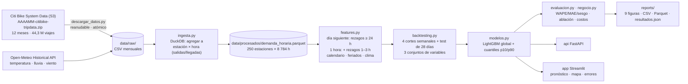
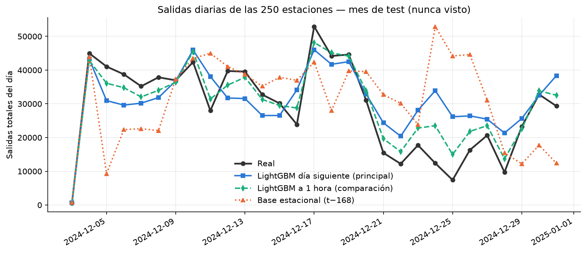
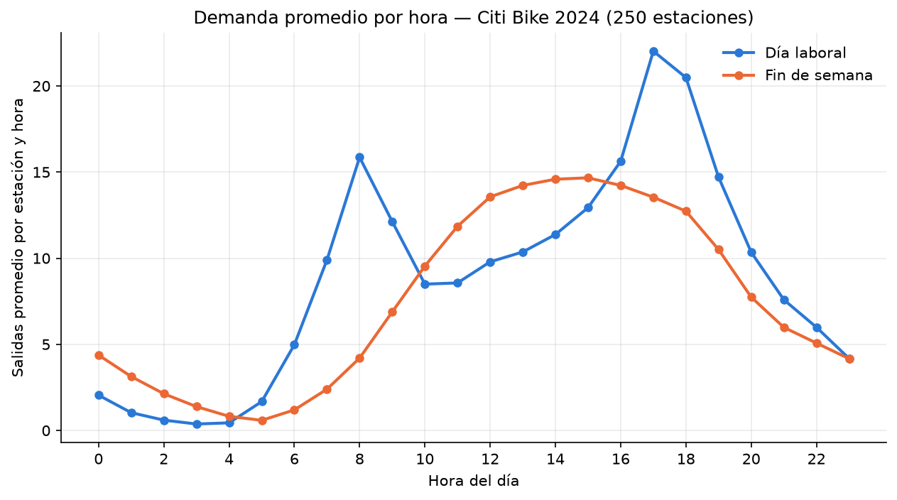
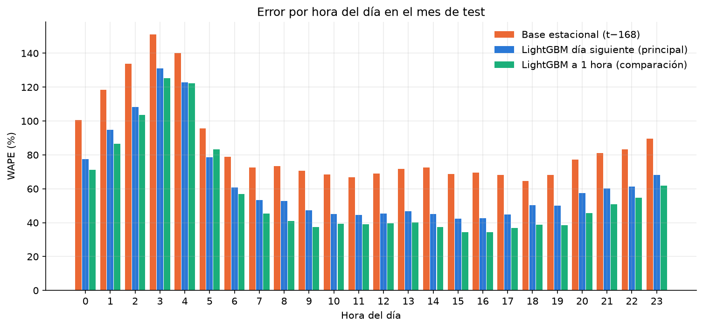
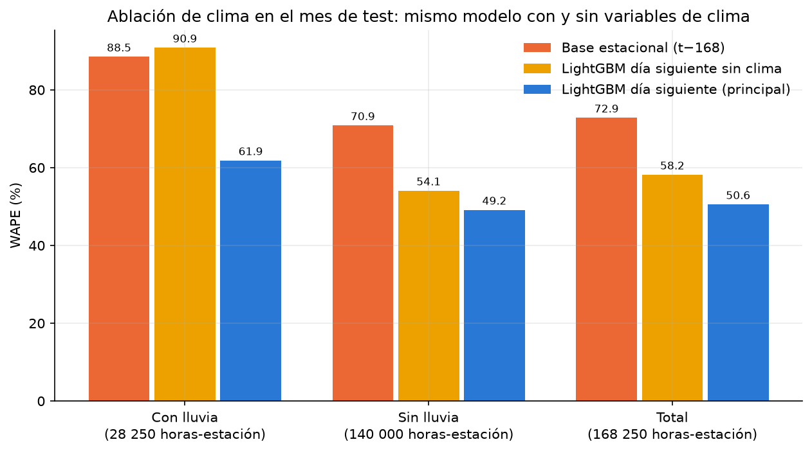
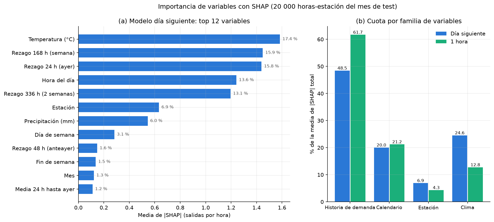
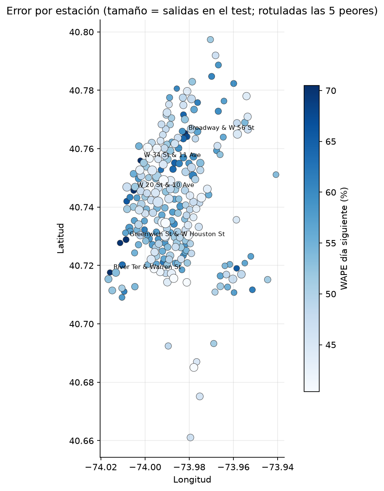
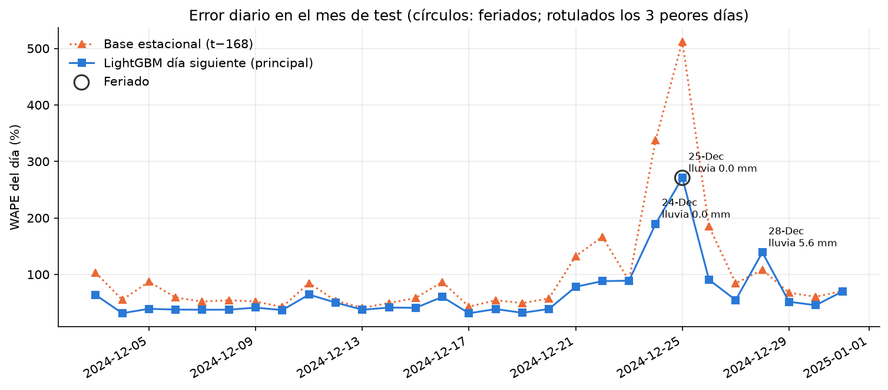
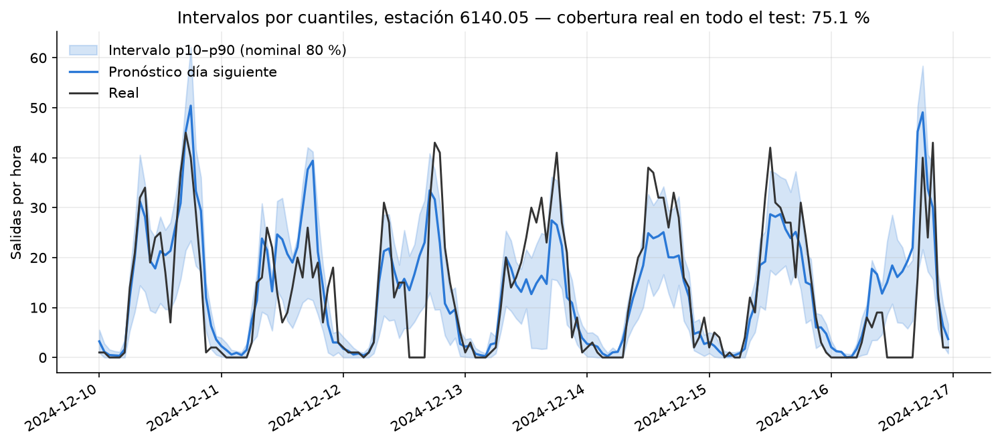
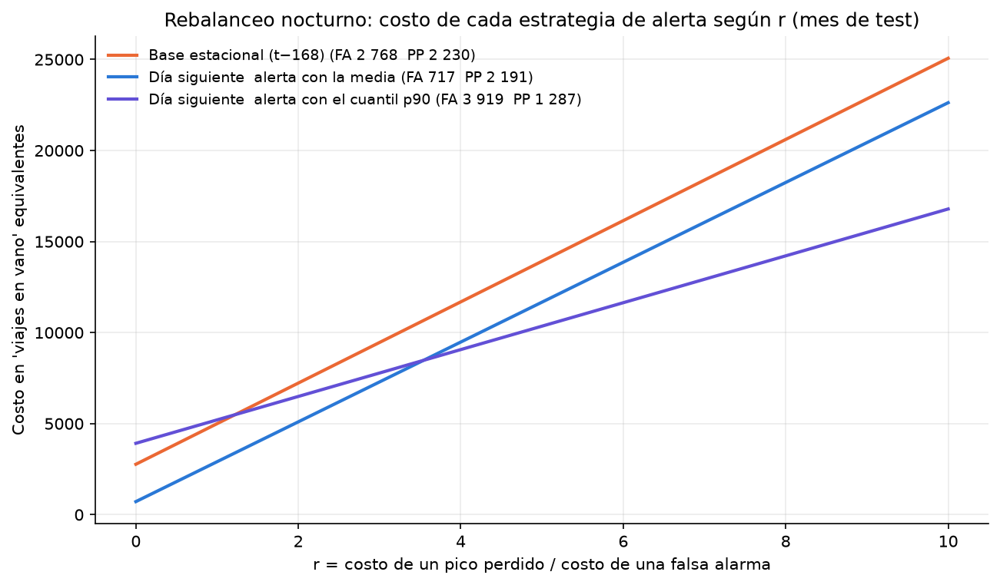

# 🚲 ¿Cuántas bicis saldrán de cada estación mañana? Pronóstico de demanda por estación y hora (Citi Bike + clima)

Citi Bike mueve decenas de miles de bicicletas al día y cada noche hay que **rebalancear**: llevar bicis a las estaciones que se vaciarán en las horas pico de mañana. Para decidirlo hace falta saber, **la noche anterior**, cuántas **salidas** tendrá cada estación en cada hora del día siguiente. Entreno un **modelo global LightGBM** con los **44,3 millones de viajes de Citi Bike de 2024**, agregados a las **250 estaciones más activas × 8 784 horas** (2 196 000 filas), con rezagos de demanda, calendario, feriados y **clima horario de Open-Meteo**. Lo valido con **backtesting de origen móvil** y en un **test final de 28 días nunca visto**, y traduzco el pronóstico en **alertas de rebalanceo con un análisis de costos explícito**.


---

## 📌 Preguntas que responde

Resultados en el **test final (28 días: del 3 de diciembre de 2024 a las 23:00 al 31 de diciembre de 2024; en adelante, «el test»)**, con el modelo de **horizonte de negocio** (pronóstico emitido a medianoche para las 24 horas del día siguiente):

| # | Pregunta | Técnica | Respuesta |
|---|---|---|---|
| 1 | ¿Se puede predecir la demanda de mañana por estación y hora? | LightGBM global, solo información disponible la noche anterior | **Sí**: WAPE **50,6 %** frente a **72,9 %** de la base estacional (**−30,6 %**) y 62,0 % de la base "misma hora de ayer" |
| 2 | ¿Es robusto en el tiempo? | Backtesting de origen móvil (4 semanas) | Gana a la base estacional en las 4 semanas; WAPE medio **38,4 %** frente a 54,4 % |
| 3 | ¿Cuánto se pierde por pronosticar con un día de anticipación? | Mismo modelo con la hora anterior (pronóstico a 1 h) | El modelo a 1 hora llega a **42,3 %**, pero no sirve para planificar la noche anterior |
| 4 | ¿El clima aporta señal? | **Ablación**: el mismo modelo sin clima | **Sí**: sin clima el WAPE sube a **58,2 %** y el sesgo a +22,6 %; con lluvia pasa de 90,9 % a 61,9 % |
| 5 | ¿Qué variables mueven la predicción? | SHAP (una sola métrica) | Historia de demanda 48,5 %, **clima 24,6 %** (la temperatura es la variable n.º 1), calendario 20,0 % |
| 6 | ¿Cuán fiables son los intervalos? | Modelos por cuantil p10/p90 | Cobertura real **75,1 %** (nominal 80 %): intervalo algo estrecho |
| 7 | ¿Qué gana el negocio? | Alertas de pico con costo de falsas alarmas y picos perdidos | Con la media, menos falsas alarmas (717 vs 2 768) y algunos picos perdidos menos que la base; si un pico perdido cuesta más de **3,5** falsas alarmas, conviene alertar con el cuantil p90 (recall 58,1 %) |

## 🏗️ Arquitectura



Un comando ejecuta todo: `python descargar_datos.py` (descarga 8,7 GB, reanudable) y `python -m demanda_citibike.pipeline` (ingesta + 3 backtestings + evaluación, **~8 min** en CPU).

## 🧹 Ingeniería de datos

| Problema real | Solución |
|---|---|
| 44,3 M de viajes en CSV (8,7 GB) no caben en pandas | **DuckDB** agrega en streaming `GROUP BY estación, hora` (salidas y llegadas) y deja una tabla de 2 196 000 filas apta para pandas |
| Los CSV de enero traen viajes iniciados el 31-12-2023 | La grilla se recorta al año calendario 2024: 366 días × 24 = **8 784 horas** por estación, con ceros explícitos en las horas sin viajes |
| La descarga puede interrumpirse | `descargar_datos.py` es **idempotente y reanudable**: descarga por mes, extrae y salta lo ya presente; escritura atómica (`.parcial` → renombrar) |
| **Horizonte de pronóstico** | El rebalanceo se decide la noche anterior: el modelo principal solo usa rezagos de **24 h o más** (`lag_24`, `lag_48`, `lag_168`, `lag_336`) y medias móviles hasta ayer. Una prueba altera las 24 h previas a cada hora y verifica que sus variables no cambian |
| Fuga de información en los rezagos | Rezagos y medias móviles con `groupby(estación).shift(...)`; la media móvil se calcula por estación sobre la serie ya desplazada |
| Validación engañosa en series temporales | **Backtesting de origen móvil** (4 cortes semanales) + **test final de 28 días nunca visto**; nunca k-fold aleatorio. Los 3 modelos usan los mismos cortes y las mismas filas |
| El clima real no está disponible al predecir | Se usa el **clima real** como sustituto del pronóstico meteorológico a 24 h (limitación documentada) |
| MAPE explota con demanda cero | Se usa **WAPE** (Σ\|error\| / Σ real), robusto a horas sin salidas |
| Predicciones negativas del regresor (2,61 % de las horas) | Se recortan a 0 en el pipeline, la API y la app |
| Las predicciones del test y del backtesting son millones de filas | Se guardan en **Parquet zstd** (`reports/predicciones_test.parquet` y `predicciones_cv.parquet`, ~2 MB cada uno) en vez de CSV; se regeneran con el pipeline |

## 📊 Resultados

### 1 · Horizonte de negocio: el modelo reduce el error un 30,6 % frente a la base estacional

Evaluado en los **últimos 28 días: del 3 de diciembre de 2024 a las 23:00 al 31 de diciembre de 2024 (673 horas por estación, 168 250 horas-estación)**, nunca vistos en entrenamiento. Todas las cifras salen de [`reports/resultados.json`](reports/resultados.json) y se pueden recalcular desde `reports/predicciones_test.parquet` (lo comprueba `tests/test_readme_cifras.py`):

| Modelo | Disponible la noche anterior | MAE | RMSE | WAPE | Sesgo |
|---|:---:|---:|---:|---:|---:|
| Base estacional (misma hora, semana anterior) | ✅ | 3,64 | 5,80 | 72,9 % | +7,4 % |
| Base "misma hora de ayer" | ✅ | 3,10 | 4,91 | 62,0 % | +1,7 % |
| LightGBM día siguiente **sin clima** (ablación) | ✅ | 2,91 | 4,31 | 58,2 % | +22,6 % |
| **LightGBM día siguiente (principal)** | ✅ | **2,53** | **3,85** | **50,6 %** | +7,4 % |
| *Comparación: base media móvil 3 h* | ❌ | 3,03 | 4,74 | 60,6 % | +0,3 % |
| *Comparación: LightGBM a 1 hora* | ❌ | 2,12 | 3,18 | 42,3 % | +3,7 % |

* El modelo de negocio mejora el WAPE un **30,6 %** frente a la base estacional y un **18,5 %** frente a "misma hora de ayer".
* En el **backtesting** (4 semanas, 5 nov – 3 dic) gana a la base en cada semana: WAPE **38,4 %** frente a 54,4 % (−29,4 %). Por semana: 31,2 / 31,2 / 43,7 / 60,4 % frente a 45,9 / 43,0 / 67,3 / 76,8 % de la base; la cuarta incluye Acción de Gracias.
* **Sobre el modelo a 1 hora:** se reporta solo como comparación: usa la demanda de la hora anterior, que no se conoce cuando se planifica el rebalanceo la noche antes. Ver la última hora baja el WAPE de 50,6 % a 42,3 %: es el costo de pronosticar con un día de anticipación, no una mejora alcanzable para esta decisión.
* El test cae en **diciembre** (demanda baja, Navidad, clima invernal) y es más difícil que el backtesting de noviembre.



### 2 · La demanda tiene un ritmo diario marcado



* Dos picos de **hora punta** (≈ 8 h y ≈ 17–18 h) en días laborales; el fin de semana es una meseta al mediodía.
* El error relativo es menor en las horas de mucha demanda y enorme de madrugada (pocas salidas: un error absoluto pequeño es un WAPE alto). Detalle por hora en `reports/error_por_hora.csv`:



### 3 · El clima sí aporta señal (ablación)

Mismo modelo día siguiente, mismos cortes, **con y sin** las 4 variables de clima (temperatura, precipitación, lluvia, viento):

| Condición | Horas-estación | Base estacional | Sin clima | **Con clima** |
|---|---:|---:|---:|---:|
| Con lluvia | 28 250 | 88,6 % | 90,9 % | **61,9 %** |
| Sin lluvia | 140 000 | 70,9 % | 54,1 % | **49,2 %** |
| Total | 168 250 | 72,9 % | 58,2 % | **50,6 %** |

* Quitar el clima **empeora el WAPE un 13,1 %** en el test y un 15,0 % en el backtesting. El efecto es enorme **cuando llueve**: sin clima el modelo no sabe que la demanda caerá y su WAPE (90,9 %) es peor que el de la base.
* Sin clima el modelo sobreestima (+22,6 % de sesgo): con solo rezagos de días anteriores no ve que el frío de diciembre reduce los viajes; la temperatura le da esa información.
* Medir el aporte del clima con la importancia por *gain* del modelo a 1 hora (que se apoya en la hora anterior) llevaría a concluir que «el clima aporta poco»; la ablación muestra lo contrario para el horizonte de negocio. La importancia de variables no mide cuánto mejora el error.



### 4 · Qué variables mueven la predicción (SHAP)

Importancia medida con **una sola métrica**: la media de |SHAP| sobre 20 000 horas-estación del test, en salidas por hora, y su porcentaje del total ([`reports/importancia_shap.csv`](reports/importancia_shap.csv)). Tabla y figura usan la misma métrica.



| Variable (modelo día siguiente) | Media \|SHAP\| (salidas/h) | % del total |
|---|---:|---:|
| Temperatura | 1,58 | 17,4 % |
| Rezago 168 h (misma hora, semana anterior) | 1,45 | 15,9 % |
| Rezago 24 h (misma hora, ayer) | 1,44 | 15,8 % |
| Hora del día | 1,24 | 13,6 % |
| Rezago 336 h (dos semanas antes) | 1,20 | 13,1 % |
| Estación | 0,63 | 6,9 % |
| Precipitación | 0,54 | 6,0 % |

| Familia | Día siguiente | 1 hora |
|---|---:|---:|
| Historia de demanda (rezagos y medias) | 48,5 % | 61,7 % |
| Clima | **24,6 %** | 12,8 % |
| Calendario | 20,0 % | 21,2 % |
| Estación | 6,9 % | 4,3 % |

* Sin la hora anterior, el modelo se apoya más en el clima: su peso SHAP casi se duplica frente al modelo a 1 hora.
* Parte del peso de la temperatura es **estacional** (en diciembre hace frío y hay menos viajes); SHAP mide cuánto mueve cada variable la predicción, no si mejora el error. Esa pregunta la responde la ablación de la sección 3.

### 5 · Errores por estación y por día (eventos)



* El modelo gana a la base estacional en **todas** las estaciones con salidas en diciembre. El error relativo es mayor en las estaciones con menos volumen; las peores (WAPE 72–77 %) están junto al río Hudson y en Midtown oeste (W 34 St & 11 Ave, W 20 St & 10 Ave, Broadway & W 56 St). Detalle en `reports/error_por_estacion.csv` y en el mapa de la app.
* **3 estaciones no tuvieron ninguna salida en diciembre** (cerradas o con ID cambiado): el modelo no puede saberlo de antemano. Su WAPE queda sin definir en el CSV.



* Los peores días son **Nochebuena y Navidad** (WAPE 190 % y 271 %: el modelo espera un martes y miércoles normales) y el **28 de diciembre**, con 5,6 mm de lluvia. En Nochebuena y Navidad el modelo es mucho mejor que la base (que copia la semana anterior), pero el 28 de diciembre es peor (139 % frente a 108 %). Los feriados con comportamiento propio no están bien representados con un solo año de datos. `reports/error_por_dia.csv` tiene el detalle.

### 6 · Intervalos de predicción (cuantiles)



* Dos modelos por cuantil (p10 y p90) del modelo día siguiente dan un intervalo nominal del **80 %**. La **cobertura real es 75,1 %**: el intervalo es algo estrecho (subestima la incertidumbre en unos 5 puntos): el 14,0 % de las horas queda por encima del p90 y el 10,9 % por debajo del p10, así que falla sobre todo en los picos.

### 7 · Valor de negocio: alertas de rebalanceo con costos explícitos

**Supuestos** (en [`negocio.py`](src/demanda_citibike/negocio.py)): un **pico** es una hora en que las salidas superan el percentil 90 de esa estación en el entrenamiento (3 075 de 168 250 horas-estación del test). Cada noche se emite una **alerta** por cada estación-hora de mañana cuyo pronóstico supera ese umbral, y cada alerta es un viaje de camión. Hay dos errores: **falsa alarma** (viaje en vano) y **pico perdido** (estación vacía, viajes no servidos). Costo = falsas alarmas + **r** × picos perdidos, con *r* desconocido: no hay datos de costos operativos ni de ingresos perdidos.

| Estrategia (disponible la noche anterior) | Alertas | Aciertos | Falsas alarmas | Picos perdidos | Precisión | Recall |
|---|---:|---:|---:|---:|---:|---:|
| Base estacional | 3 613 | 845 | 2 768 | 2 230 | 23,4 % | 27,5 % |
| Día siguiente, alerta con la media | 1 601 | 884 | 717 | 2 191 | 55,2 % | 28,7 % |
| Día siguiente, alerta con el cuantil p90 | 5 707 | 1 788 | 3 919 | 1 287 | 31,3 % | 58,1 % |

| Costo (viajes en vano equivalentes) | r = 1 | r = 2 | r = 5 | r = 10 |
|---|---:|---:|---:|---:|
| Base estacional | 4 998 | 7 228 | 13 918 | 25 068 |
| Día siguiente, media | **2 908** | **5 099** | 11 672 | 22 627 |
| Día siguiente, p90 | 5 206 | 6 493 | **10 354** | **16 789** |



* **Con la media**, el modelo **domina** a la base: 2 051 falsas alarmas menos *y* 39 picos perdidos menos. Pero su recall sigue bajo (28,7 %): el modelo tiende a la media y no llega al umbral en la mayoría de los picos. Por eso el costo cuenta las dos cosas: una falsa alarma evitada no es un «viaje ahorrado» si en el camino se pierden picos.
* **Con el cuantil p90**, detecta el doble de picos (58,1 %) a cambio de más falsas alarmas. Es más barato que alertar con la media si un pico perdido cuesta **más de 3,5 falsas alarmas** (razón de equilibrio 3,54), y más barato que la base desde *r* = 1,22.
* La elección de la regla depende de *r*, que debe fijar el operador. El [notebook 04](notebooks/04_negocio_rebalanceo.ipynb) barre el umbral de alerta y da el punto óptimo para cada *r*.

## 🖥️ API y app

```bash
uvicorn api.main:app --reload          # http://127.0.0.1:8000
streamlit run app/streamlit_app.py     # http://localhost:8501
```

* `GET /pronostico/{estacion}?fecha=2024-12-20` → pronóstico horario del día con el modelo **día siguiente** y las salidas reales para comparar.
* La app tiene tres pestañas: **pronóstico** (real vs día siguiente vs 1 hora vs base para cada estación y día), **mapa de estaciones** (OpenStreetMap, color = WAPE, tamaño = demanda) y **análisis de errores** (peores y mejores estaciones, error vs volumen, error por día con feriados y lluvia).

## 📓 Notebooks (ejecutados, con resultados)

1. [Ingesta y agregación](notebooks/01_ingesta_agregacion.ipynb): 44,3 M de viajes, selección de las 250 estaciones, estacionalidad, ceros, mapa
2. [Características y horizonte](notebooks/02_features.ipynb): diseño día siguiente vs 1 hora, prueba empírica de no fuga, autocorrelación, clima en bruto
3. [Evaluación del modelo](notebooks/03_evaluacion_modelo.ipynb): métricas por horizonte, folds, ablación de clima, SHAP, cobertura, errores por estación y por día, residuos
4. [Negocio: rebalanceo](notebooks/04_negocio_rebalanceo.ipynb): falsas alarmas vs picos perdidos, sensibilidad al costo, curva de umbral

## 🧠 Decisiones técnicas

* **El horizonte lo define el negocio.** El rebalanceo se planifica la noche anterior, así que el modelo principal pronostica las 24 horas de mañana con información hasta la medianoche: solo rezagos de 24 h o más. El modelo a 1 hora se conserva como comparación para medir cuánto cuesta esa anticipación.
* **Un modelo global para 250 estaciones** (la estación es categórica): comparte información entre estaciones y se entrena una sola vez, en vez de 250 modelos inestables.
* **"Mes" como variable numérica, no categórica:** el test cae en diciembre, que no aparece en el entrenamiento; como categoría sería un nivel nunca visto.
* **DuckDB para la ingesta**: agrega 44,3 M de viajes en streaming, sin cargar los CSV en pandas.
* **LightGBM en vez de una red recurrente**: para 2,1 M de filas de modelado y ~20 variables, los árboles con boosting son rápidos, robustos y explicables con SHAP; no requieren GPU.
* **Backtesting de origen móvil y test final de 28 días nunca visto**, con los mismos cortes para todos los modelos.
* **Hiperparámetros de LightGBM fijos, sin búsqueda.** Se usó una configuración razonable y fija (`PARAMS_LGBM` en [`modelos.py`](src/demanda_citibike/modelos.py): tasa de aprendizaje 0,05, 63 hojas, 600 árboles como máximo, `subsample` y `colsample_bytree` 0,8, semilla 42) y solo el número de árboles se ajusta con *early stopping* sobre los 14 días previos a cada corte. No se afinó nada con el test ni con el backtesting, así que las cifras no están infladas por buscar hiperparámetros; a cambio, una búsqueda (por ejemplo con Optuna sobre los cortes del backtesting) podría mejorarlas algo. Los modelos de cuantil usan los mismos parámetros con 400 árboles.
* **Líneas base siempre**: estacional (t−168) y "ayer" (t−24), las dos disponibles la noche anterior; la media móvil de 3 h solo como comparación a 1 hora.
* **Ablación para medir el aporte del clima**, no la importancia de variables: SHAP dice cuánto mueve una variable la predicción, no si mejora el error.
* **Intervalos por cuantiles** (p10/p90) y medición de la **cobertura real**, no solo la nominal.

### Selección de las 250 estaciones

Datos en [`reports/seleccion_estaciones.json`](reports/seleccion_estaciones.json), generado por `ingesta.resumir_seleccion()` a partir de los CSV crudos:

* **Criterio:** las 250 estaciones con más salidas en 2024 (la ficha pedía 200–300 de las más activas). De 2 378 estaciones con salidas, estas 250 (~10 %) concentran **18 176 018 salidas, el 41,0 %** de los 44 302 799 viajes del año.
* **Para quién sirve:** la estación 250 tiene 50 301 salidas en el año, unas 6 veces la mediana del sistema (≈ 8 250). Son las estaciones donde el rebalanceo más importa; el modelo **no** representa a las pequeñas ni a las nuevas.
* **¿Fuga por selección?** Elegirlas con el año completo usa información de diciembre (los 28 días de test). Si se eligen solo con enero–noviembre coinciden **247 de 250**, así que el efecto es despreciable; aun así, en producción la selección debe hacerse solo con el pasado.
* **Por qué no todas:** con 2 378 series, la mayoría con muy pocos viajes por hora, el WAPE lo dominarían estaciones casi vacías y el entrenamiento sería 10 veces más lento, sin ganar nada para la decisión de rebalanceo.

## 🚀 Cómo ejecutarlo

Guía detallada para Windows, con preguntas de entrevista: **[docs/GUIA_PASO_A_PASO.md](docs/GUIA_PASO_A_PASO.md)**

```bash
python -m venv .venv && .venv\Scripts\activate
pip install -r requirements.txt               # versiones fijadas
pip install -e .
pytest                                       # 41 pruebas
uvicorn api.main:app --reload                # API (funciona en un clon recién descargado)
streamlit run app/streamlit_app.py           # app

# Solo para regenerar todo desde cero:
python descargar_datos.py                    # 12 meses de viajes + clima (reanudable, 8,7 GB)
python -m demanda_citibike.pipeline          # ingesta + 3 backtestings + evaluación (~8 min)
```

La API y la app **funcionan en un clon sin descargar nada**: el repositorio incluye el modelo (`models/`), la demanda horaria agregada (`data/procesados/demanda_horaria.parquet`, 7,8 MB, con `estaciones.csv`) y el clima horario (`data/raw/clima_nyc_horario.csv`, 0,3 MB). Los 12 zips y CSV de viajes de `data/raw/` (≈ 17 GB) están ignorados por git y se bajan con `descargar_datos.py` solo si se quiere re-ejecutar la ingesta. Los archivos de `reports/` y `models/` también se regeneran con el pipeline.

## 📁 Estructura

```
├── descargar_datos.py          viajes Citi Bike (12 meses) + clima Open-Meteo, reanudable
├── src/demanda_citibike/
│   ├── config.py               rutas, periodo, rezagos de cada horizonte, constantes
│   ├── ingesta.py              DuckDB: viajes → salidas/llegadas por estación × hora; selección de estaciones
│   ├── clima.py                clima horario + feriados de NY
│   ├── features.py             variables día siguiente (rezagos ≥ 24 h) y 1 hora, sin fuga
│   ├── modelos.py              LightGBM global + cuantiles + líneas base
│   ├── backtesting.py          origen móvil (4 cortes) + test de 28 días, para cualquier conjunto de variables
│   ├── evaluacion.py           MAE, RMSE, WAPE, sesgo, cobertura
│   ├── negocio.py              alertas de pico, falsas alarmas vs picos perdidos, costos
│   ├── graficos.py             9 figuras + SHAP
│   └── pipeline.py             orquestador
├── api/main.py                 FastAPI (modelo día siguiente)
├── app/streamlit_app.py        pronóstico, mapa de estaciones y análisis de errores
├── notebooks/                  4 notebooks ejecutados
├── tests/                      41 pruebas (datos sintéticos, API con TestClient, verificación de cifras del README)
├── data/muestra/               muestra para CI (versionada)
├── data/procesados/            demanda horaria (Parquet) y estaciones: versionados; lo demás se regenera
├── data/raw/                   clima horario (versionado) y CSV de viajes (ignorados por git; .gitkeep)
├── models/                     modelo_lgbm.joblib (día siguiente) y modelo_1h.joblib (comparación)
└── reports/                    figuras, CSV, predicciones en Parquet y resultados.json
```

## 📚 Fuentes y licencias

* **Citi Bike System Data** — [tripdata S3](https://s3.amazonaws.com/tripdata/), operado por Lyft. Bajo la [licencia de datos de Citi Bike](https://ride.citibikenyc.com/data-sharing-policy) (uso público con atribución). Archivos `AAAAMM-citibike-tripdata.zip` de enero a diciembre de 2024.
* **Clima** — [Open-Meteo Historical API](https://open-meteo.com/) (temperatura a 2 m, precipitación, lluvia y viento a 10 m, hora local de Nueva York). Datos bajo [CC BY 4.0](https://creativecommons.org/licenses/by/4.0/); el CSV con ese clima se incluye en el repositorio con esa atribución.
* **Feriados** — librería [`holidays`](https://pypi.org/project/holidays/) (feriados de EE. UU. / estado de Nueva York).
* Métodos: LightGBM (Ke et al., 2017), SHAP (Lundberg & Lee, 2017), WAPE.

Datos descargados en **octubre de 2026**.

**Licencia:** el **código** de este repositorio es MIT (ver [LICENSE](LICENSE)). Los **datos** siguen su propia licencia: los viajes, la de Citi Bike/Lyft, y el clima, CC BY 4.0 (Open-Meteo). La demanda horaria agregada que se incluye es un resumen derivado de los viajes públicos, sin datos personales.

> **Limitaciones:** se modelan solo las 250 estaciones más activas (41,0 % de los viajes); el clima **real** se usa como pronóstico a 24 h (el error meteorológico no está modelado y probablemente empeore el resultado en días de lluvia); no se modela el stock de bicicletas por estación (el rebalanceo usa el percentil 90 histórico como umbral); los feriados con comportamiento propio (Nochebuena, Navidad) y los cierres de estaciones no están en las variables; los intervalos están algo subcoberturados (75,1 % frente a 80 %); un solo año de datos.

## 👤 Autor

**Erick Guarnizo** · Ingeniero en Sistemas · [LinkedIn](https://www.linkedin.com/in/erick-g-571a7b3b4)
