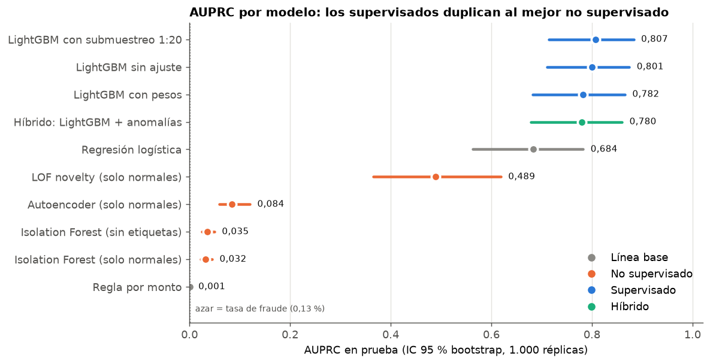
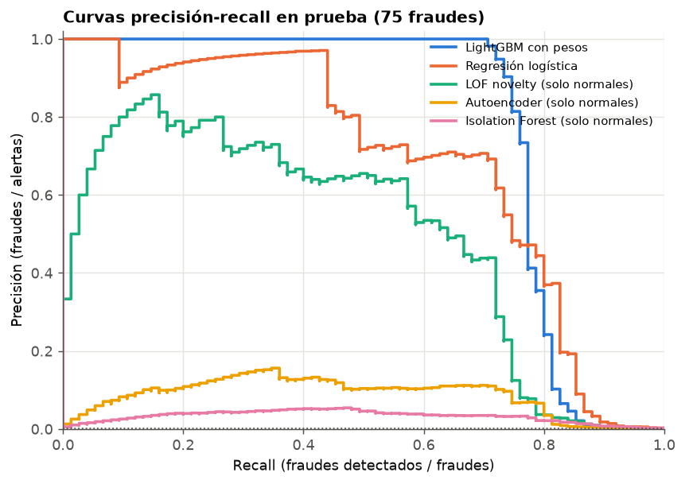
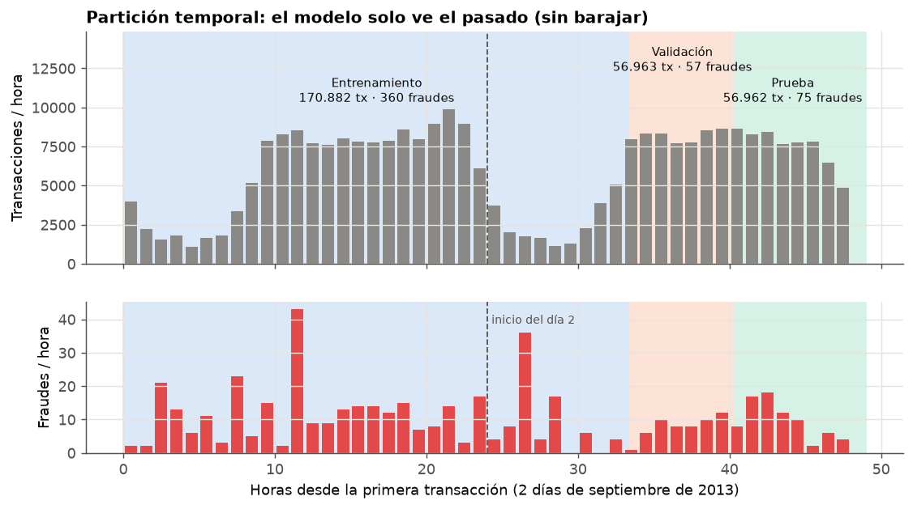
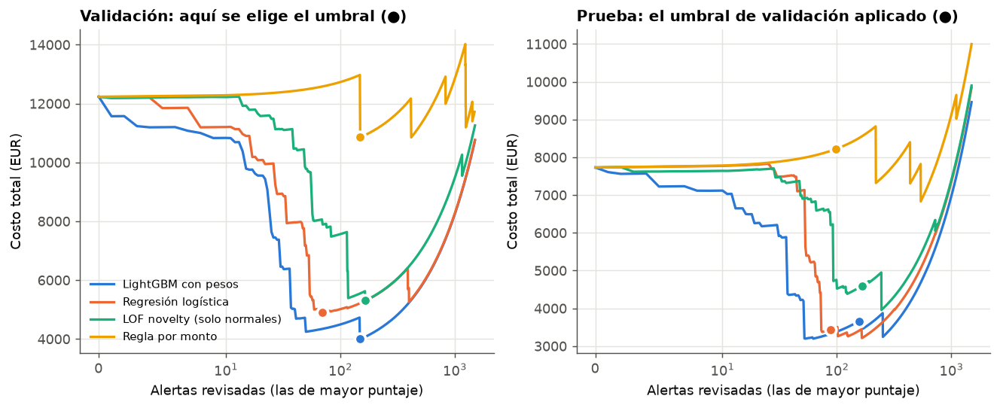
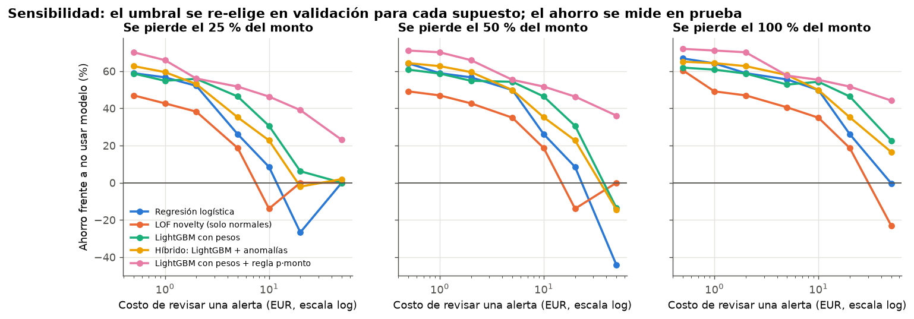
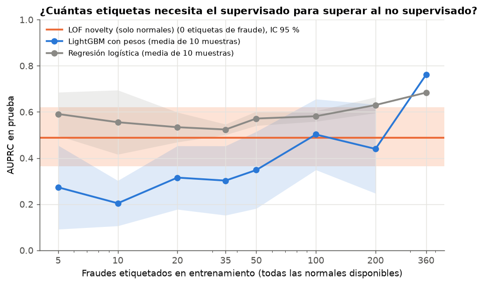
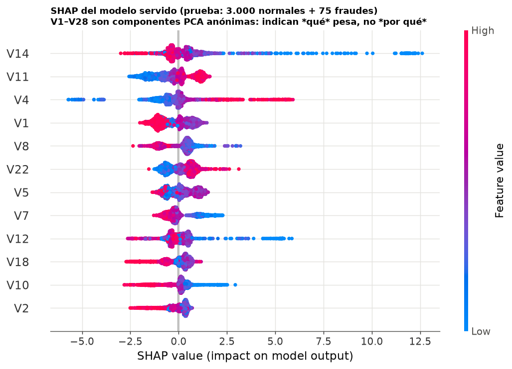
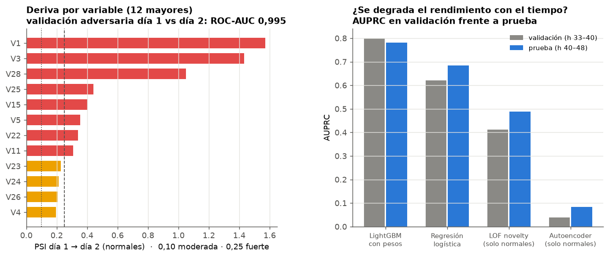
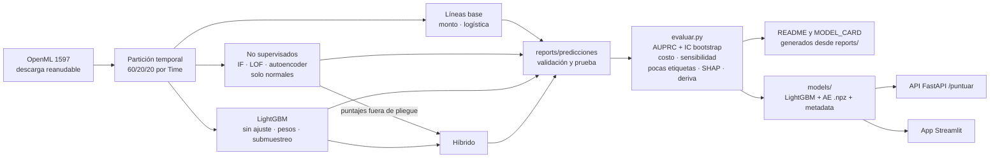

# 💳 Detección de fraude con tarjetas: anomalías no supervisadas frente a modelos supervisados

**Datos:** 284.807 transacciones reales de titulares europeos (ULB / Worldline, dos días de septiembre de 2013), con **492 fraudes (0,17 %)**.

¿Hace falta etiquetar fraudes o basta con buscar lo **raro**? Este proyecto compara, con una **partición temporal** (entrenar con el pasado y evaluar con el futuro):
- **Líneas base:** una regla por monto y una regresión logística.
- **No supervisados:** Isolation Forest (sin etiquetas y solo con normales), LOF en modo *novelty* y un **autoencoder** en PyTorch (CPU).
- **Supervisados:** LightGBM sin ajuste, con **pesos** y con **submuestreo**.
- **Híbrido:** LightGBM con los puntajes de anomalía como variables.

Las decisiones se toman con el **costo de cada error** usando el `Amount` real: el umbral se elige en validación y se reporta en prueba, con intervalos bootstrap y análisis de sensibilidad. Incluye una curva de **pocas etiquetas**, **SHAP**, **deriva** entre días, una API FastAPI (`/puntuar`) y una app Streamlit.


---

## 🏆 Resultados en prueba (últimas 7,7 horas: 56.962 transacciones, 75 fraudes)

Métrica principal: **AUPRC** (área bajo la curva precisión-recall). Con 0,13 % de fraude en prueba, un modelo al azar obtiene AUPRC ≈ 0,0013 y «todo es normal» tiene una exactitud del 99,87 %: por eso **nunca se reporta exactitud**. Precisión@80 = alertas que puede revisar un equipo de 250 alertas al día en esas 7,7 horas. IC 95 %: bootstrap pareado con 1.000 réplicas. El costo usa el umbral elegido **en validación** (supuestos en la sección de costo).

| Familia | Modelo | AUPRC [IC 95 %] | ROC-AUC | Precisión@80 | Recall a precisión ≥ 80 % | Costo en prueba [IC 95 %] | Ahorro vs. sin modelo |
| :--- | :--- | ---: | ---: | ---: | ---: | ---: | ---: |
| Supervisado | LightGBM con submuestreo 1:20 | 0,807 [0,715; 0,883] | 0,984 | 73,8 % | 76,0 % | 2.934 EUR [836; 5.680] | 62,0 % |
| Supervisado | LightGBM sin ajuste | 0,801 [0,710; 0,874] | 0,981 | 72,5 % | 76,0 % | 3.237 EUR [1.181; 6.142] | 58,1 % |
| Supervisado | **LightGBM con pesos** ⭐ | 0,782 [0,682; 0,865] | 0,928 | 72,5 % | 76,0 % | 3.651 EUR [1.520; 6.720] | 52,8 % |
| Híbrido | Híbrido: LightGBM + anomalías | 0,780 [0,679; 0,860] | 0,924 | 71,2 % | 76,0 % | 3.257 EUR [1.177; 6.008] | 57,9 % |
| Línea base | Regresión logística | 0,684 [0,563; 0,782] | 0,972 | 67,5 % | 49,3 % | 3.439 EUR [1.306; 6.495] | 55,5 % |
| No supervisado | LOF novelty (solo normales) | 0,489 [0,366; 0,619] | 0,936 | 55,0 % | 26,7 % | 4.598 EUR [1.754; 8.238] | 40,5 % |
| No supervisado | Autoencoder (solo normales) | 0,084 [0,059; 0,120] | 0,928 | 2,5 % | 0,0 % | 5.452 EUR [3.151; 8.482] | 29,5 % |
| No supervisado | Isolation Forest (sin etiquetas) | 0,035 [0,025; 0,050] | 0,950 | 0,0 % | 0,0 % | 8.505 EUR [6.221; 11.659] | -10,0 % |
| No supervisado | Isolation Forest (solo normales) | 0,032 [0,023; 0,045] | 0,949 | 0,0 % | 0,0 % | 8.343 EUR [5.957; 11.617] | -7,9 % |
| Línea base | Regla por monto | 0,001 [0,001; 0,003] | 0,382 | 0,0 % | 0,0 % | 8.219 EUR [4.125; 13.397] | -6,3 % |

⭐ Modelo servido en la API: el de mayor AUPRC **en validación** (0,800). En prueba, los tres LightGBM y el híbrido no se distinguen entre sí (ver diferencias pareadas).

| AUPRC con IC 95 % por modelo | Curvas precisión-recall en prueba |
| :---: | :---: |
|  |  |

### Hallazgos clave

1. **El supervisado gana con holgura.** LightGBM con pesos: AUPRC 0,782 frente a 0,489 del mejor no supervisado, LOF novelty (solo normales). La diferencia pareada es 0,284 [0,184; 0,387]. Incluso la regresión logística (0,684) supera al mejor no supervisado por 0,187 [0,103; 0,279].
2. **Raro no es lo mismo que fraudulento.** Isolation Forest (0,032) y el autoencoder (0,084) tienen ROC-AUC de 0,949 y 0,928, que parece buena, pero sus primeras alertas son compras legítimas inusuales: precisión@80 de 0,0 % y 2,5 %. LOF, que mide densidad *local*, sí encuentra los grupos de fraude (55,0 %).
3. **Con solo 5 fraudes etiquetados**, una regresión logística ya supera al mejor no supervisado (AUPRC 0,591 frente a 0,489). LightGBM necesita muchas más etiquetas: pasa la referencia por primera vez con 100 y solo de forma estable con todos los 360.
4. **El manejo del desbalance no cambia el ranking.** Pesos − submuestreo: -0,025 [-0,063; 0,004]. Pesos − sin ajuste: -0,019 [-0,054; 0,010]. Los pesos sí bajan la ROC-AUC (0,928 frente a 0,981) y descalibran las probabilidades. El **híbrido** tampoco aporta: -0,002 [-0,017; 0,012].
5. **Ordenar por monto es peor que el azar** (AUPRC 0,001, ROC-AUC 0,382): la mediana de un fraude es 9,25 EUR y la de una compra normal 22,00 EUR. Los defraudadores prueban con montos pequeños.

---

## 📌 El problema y las reglas de evaluación

- **Desbalance extremo:** 1 fraude por cada 474 transacciones normales en entrenamiento.
- **El futuro no se ve.** La partición es **temporal** por `Time`, sin barajar. Se corta por *valores* de tiempo, así que todas las transacciones del mismo segundo caen juntas, incluidos los 1.081 duplicados exactos:

| Partición | Horas | Transacciones | Fraudes | Tasa | Monto defraudado |
| :--- | :---: | ---: | ---: | ---: | ---: |
| Entrenamiento | 0 → 33,4 | 170.882 | 360 | 0,211 % | 40.168 EUR |
| Validación | 33,4 → 40,4 | 56.963 | 57 | 0,100 % | 12.231 EUR |
| Prueba | 40,4 → 48,0 | 56.962 | 75 | 0,132 % | 7.729 EUR |



¿Por qué no una partición aleatoria? Los fraudes llegan en **ráfagas** (hasta 43 en una hora, mismo patrón de ataque repetido en minutos). Si se baraja, el modelo ve en entrenamiento «hermanos» casi idénticos de los fraudes de prueba y la métrica se infla. Además, en producción el modelo siempre puntúa transacciones posteriores a las que aprendió.

**Todo lo que se decide usa validación:** la parada temprana de LightGBM, el esquema de desbalance, el modelo servido, la calibración de Platt y el umbral. La prueba solo se usa para reportar.

---

## 💶 Costo por error (con `Amount` real)

**Supuestos explícitos** (en `src/fraude/config.py`):
- Revisar una alerta cuesta **5 EUR**: unos 6 minutos de un analista a ~50 EUR/h. Se paga sea fraude o no.
- Un fraude **no detectado** cuesta el **100 % de su `Amount`** (sin contracargo).
- Un fraude alertado se bloquea a tiempo y no genera pérdida (supuesto optimista).
- **Sin modelo**, en prueba se pierden 7.729 EUR.

El umbral se elige minimizando el costo **en validación** y se aplica tal cual en prueba. La **regla de pérdida esperada** alerta si `p_calibrada × Amount > 5 EUR`, con la probabilidad calibrada por Platt en validación (2 parámetros, robusta con solo 57 fraudes).

| Política (modelo servido) | Alertas | Fraudes detectados / 75 | Falsas alertas | Monto protegido | Costo total [IC 95 %] | Ahorro |
| :--- | ---: | ---: | ---: | ---: | ---: | ---: |
| Umbral por costo elegido en validación | 157 | 59 | 98 | 4.864 EUR | 3.651 EUR [1.520; 6.720] | 52,8 % |
| Pérdida esperada: p calibrada × monto > 5 EUR | 70 | 22 | 48 | 4.801 EUR | 3.278 EUR [1.190; 6.314] | 57,6 % |
| Capacidad fija: top 80 (250 alertas/día) | 80 | 58 | 22 | 4.846 EUR | 3.283 EUR [1.173; 6.320] | 57,5 % |

| Curva de costo: validación (se elige) y prueba (se aplica) | Sensibilidad a los supuestos |
| :---: | :---: |
|  |  |

**Lectura:**
- Con 5 EUR por alerta, las tres políticas del modelo servido ahorran entre 52,8 % y 57,6 % frente a no usar modelo.
- Los IC del costo son **anchos y se solapan**: con 75 fraudes, unos pocos de montos altos deciden el resultado (el mayor fraude de prueba, 1.505 EUR, equivale a 301 revisiones).
- La regla de pérdida esperada detecta menos fraudes (22 frente a 59), pero deja pasar sobre todo fraudes de pocos euros: revisarlos cuesta más de lo que se perdería.

**Sensibilidad** (se pierde el 100 % del monto; el umbral se re-elige en validación para cada costo; en negrita el mejor):

| Costo de revisar | Regresión logística | LOF novelty (solo normales) | LightGBM con pesos | Híbrido: LightGBM + anomalías | LightGBM con pesos + regla p·monto |
| ---: | ---: | ---: | ---: | ---: | ---: |
| 0,5 EUR | 66,8 % | 60,3 % | 61,9 % | 65,1 % | **72,0 %** |
| 1,0 EUR | 64,2 % | 49,1 % | 60,8 % | 64,3 % | **71,1 %** |
| 2,0 EUR | 58,9 % | 47,0 % | 58,7 % | 62,7 % | **70,1 %** |
| 5,0 EUR | 55,5 % | 40,5 % | 52,8 % | **57,9 %** | 57,6 % |
| 10,0 EUR | 49,8 % | 34,9 % | 54,3 % | 49,8 % | **55,3 %** |
| 20,0 EUR | 26,1 % | 18,6 % | 46,4 % | 35,2 % | **51,7 %** |
| 50,0 EUR | -0,3 % | -23,0 % | 22,7 % | 16,5 % | **44,2 %** |

Cuando revisar es caro (50 EUR por alerta), la regla de pérdida esperada mantiene un ahorro del 44,2 %, mientras que la regresión logística llega a -0,3 % y LOF a -23,0 %. Una política que usa el monto de **cada** transacción es más robusta a los supuestos que un umbral único sobre el puntaje. El archivo `reports/sensibilidad_costo.csv` incluye también los escenarios en que se pierde el 25 % o el 50 % del monto (con contracargo parcial).

---

## 🏷️ ¿Cuántas etiquetas necesita el supervisado?

Se entrena con **todas las normales** y solo *n* fraudes de entrenamiento, elegidos al azar 10 veces. No hay parada temprana: con pocas etiquetas tampoco habría una validación etiquetada confiable. La referencia es el mejor no supervisado, que usa 0 etiquetas de fraude (LOF novelty (solo normales): AUPRC 0,489 [0,366; 0,619]).

| Fraudes etiquetados | LightGBM con pesos (AUPRC media ± d.e.) | Regresión logística (AUPRC media ± d.e.) |
| ---: | ---: | ---: |
| 5 | 0,273 ± 0,182 | 0,591 ± 0,094 |
| 10 | 0,204 ± 0,098 | 0,555 ± 0,139 |
| 20 | 0,315 ± 0,138 | 0,534 ± 0,065 |
| 35 | 0,302 ± 0,150 | 0,524 ± 0,023 |
| 50 | 0,348 ± 0,167 | 0,571 ± 0,031 |
| 100 | 0,502 ± 0,154 | 0,581 ± 0,023 |
| 200 | 0,440 ± 0,193 | 0,630 ± 0,034 |
| 360 | 0,761 | 0,684 |

Con n = 360 (todos los fraudes) el LightGBM obtiene 0,761 y no 0,782 como en la tabla principal, porque aquí usa 300 árboles fijos sin parada temprana.



**Lectura:**
- Pocas etiquetas bastan si el modelo es **simple**. La logística con 5 fraudes ya supera al mejor no supervisado, porque aprende una *dirección* de fraude y usa todas las normales como referencia.
- LightGBM con pocos positivos (y pesos de hasta 34.104:1 con 5 fraudes) sobreajusta y varía mucho entre muestras: con 200 fraudes vuelve a caer por debajo de la referencia.
- Conclusión práctica: los detectores de anomalías sirven **antes** de tener etiquetas, para priorizar qué revisar y así conseguirlas. En cuanto hay unas decenas de fraudes confirmados, conviene pasar a un modelo supervisado simple.

---

## 🔍 Interpretabilidad (SHAP) y deriva temporal



- En los fraudes, las variables que más pesan son **V14, V4, V12**. `V1`–`V28` son **componentes PCA anónimas**: SHAP dice *qué* componente empuja la decisión, pero no puede traducirse a «país», «comercio» u «hora». Sirve para auditar estabilidad, no para explicarle al cliente por qué se bloqueó su tarjeta.
- **Deriva:** un clasificador distingue el día 1 del día 2 con ROC-AUC **0,995** usando solo `V1`–`V28` y el monto. Las componentes que más derivan son V1 (PSI 1,57), V3 (1,43) y V28 (1,05). El PCA se ajustó sobre los dos días juntos y recoge la tendencia temporal.
- Aun así, la AUPRC del modelo servido pasa de 0,800 en validación a 0,782 en prueba: las variables que más derivan no son las que más separan el fraude. Con más días, la deriva habría que vigilarla (PSI semanal y reentrenamiento).



---

## 🧭 Arquitectura



---

## 🧠 Decisiones

- **AUPRC como métrica principal.** La ROC-AUC premia ordenar bien decenas de miles de normales fáciles. Isolation Forest tiene ROC-AUC 0,949 y, aun así, ningún fraude entre sus primeras 80 alertas. La AUPRC mide lo que importa: cuántas alertas son fraude.
- **No supervisados entrenados solo con normales** (*novelty detection*). En la práctica las normales «etiquetadas» son gratis: son las transacciones sin reclamo. También se entrena Isolation Forest sin ninguna etiqueta: con 0,2 % de contaminación, el resultado es casi igual (0,035 frente a 0,032).
- **Autoencoder en PyTorch CPU, servido en NumPy.** Torch se instaló sin problema. Es una red densa 29 → 20 → 10 → 20 → 29 con activación tanh, entrenada 40 épocas con parada temprana sobre normales reservadas (sin mirar fraudes). Los pesos se guardan en un `.npz` de ~10 KB y la inferencia es NumPy puro: la API no importa torch.
- **Puntajes de anomalía fuera de pliegue para el híbrido.** Si el autoencoder puntúa las mismas normales con las que se entrenó, su error sale artificialmente bajo y el supervisado aprende una separación que no existe en datos nuevos. Por eso cada normal se puntúa con un detector que no la vio (3 pliegues).
- **Parada temprana por AUPRC de validación** en LightGBM (paciencia 200, tasa 0,03).
- **Submuestreo 1:20 frente a pesos ~474:1.** El submuestreo entrena en 4,8 s frente a 11,6 s y rinde igual. Ambos distorsionan las probabilidades, así que la regla de pérdida esperada usa la calibración de Platt (Dal Pozzolo et al. 2015 estudian justamente esta corrección).
- **Precisión@k desde la capacidad del equipo**: 250 alertas/día × 7,65 h / 24 = **80 alertas** en prueba.
- **Bootstrap con pesos por fila.** Cada réplica es un vector de conteos y el orden por puntaje se calcula una sola vez por modelo: 10 modelos × 1.000 réplicas en segundos. Con pesos = 1 coincide con scikit-learn (lo verifica una prueba).

## ⚠️ Limitaciones

- **Solo dos días y 75 fraudes en prueba.** Los IC de la AUPRC del modelo servido miden ±0,09, y los del costo son aún más anchos. Ninguna diferencia entre los LightGBM es significativa.
- **V1–V28 son PCA ya hechas por el banco**, y el PCA se ajustó con los dos días (incluido el «futuro»). Es una pequeña fuga de información que no se puede deshacer y que no existiría en producción.
- **Supuestos de costo simplificados**: no incluyen la fricción del cliente legítimo bloqueado, los contracargos ni que un fraude alertado pueda no recuperarse. Por eso hay análisis de sensibilidad, que no reemplaza a datos reales del negocio.
- **Duplicados exactos** (1.081 filas): se conservan porque pueden ser cobros repetidos legítimos. Al cortar por segundo no cruzan particiones.
- **Rendimiento bajo del autoencoder y de Isolation Forest.** Con componentes PCA decorrelacionadas les queda poca estructura que explotar. No se ajustó su arquitectura con las etiquetas de validación, para no convertirlos en modelos supervisados encubiertos.
- **La API sirve un solo modelo** (el LightGBM elegido en validación). El híbrido no se empaqueta porque no mejora.

---

## ▶️ Cómo reproducir

```bash
python -m venv .venv
.venv\Scripts\activate            # Windows  (Linux/Mac: source .venv/bin/activate)
pip install -r requirements.txt
pip install -e .
python descargar_datos.py          # ~73 MB desde OpenML, reanudable y validado (284.807 filas, 492 fraudes)
python -m fraude.entrenar          # entrena (2,2 min en CPU) y llama a fraude.evaluar
python -m fraude.evaluar           # solo evaluación desde reports/predicciones_*.parquet (~3 min)
python -m fraude.graficos          # figuras de reports/figures/
python scripts/generar_notebooks.py
python scripts/generar_readme.py   # README.md y MODEL_CARD.md desde reports/
pytest -q -p no:cacheprovider
```

**API** (funciona en un clon sin descargar datos: los modelos versionados pesan < 3 MB):

```bash
uvicorn api.main:app --port 8000
```

Ejemplo real con el primer fraude de la muestra de prueba (`V3`–`V27` abreviadas):

```json
POST /puntuar
{"transacciones": [{"V1": 0.909, "V2": 2.849, "...": "...", "V28": 0.360, "Amount": 1.18}]}
→ {
 "resultados": [
  {
   "puntaje_modelo": 1.0,
   "probabilidad_fraude_calibrada": 0.9782,
   "alerta_umbral_costo": true,
   "perdida_esperada_eur": 1.1543,
   "alerta_perdida_esperada": false,
   "error_reconstruccion_ae": 6.8924,
   "percentil_anomalia_ae": 99
  }
 ]
}
```

**App:** `streamlit run app/app.py`. Puntúa una muestra de prueba (500 transacciones, con los 75 fraudes de prueba) y permite mover el costo de revisión para ver cómo cambian las alertas.

## 📁 Estructura

```
├── descargar_datos.py          # descarga reanudable (HTTP Range) desde OpenML
├── src/fraude/                 # config, datos, modelos, metricas, costo, deriva, entrenar, evaluar, graficos, predecir
├── api/main.py                 # FastAPI /salud y /puntuar
├── app/app.py                  # Streamlit
├── models/                     # lgbm_servido.txt, autoencoder.npz, metadata.json
├── reports/                    # métricas, costo, sensibilidad, pocas etiquetas, SHAP, deriva, predicciones, figures/
├── notebooks/                  # 01 datos y deriva · 02 modelos y pocas etiquetas · 03 costo, SHAP y API
├── scripts/                    # generar_notebooks.py, generar_readme.py
├── tests/                      # partición sin fuga, métricas, costo, modelos, API, app, cifras del README
├── MODEL_CARD.md
└── docs/GUIA_PASO_A_PASO.md
```

## 📚 Datos, licencia y cita

- **Datos:** *Credit Card Fraud Detection*, Machine Learning Group de la Université Libre de Bruxelles (ULB) y Worldline. Se descargan de OpenML (dataset 1597, «creditcard»). Licencia de los datos: **Open Database License (ODbL) 1.0**, según la publicación original del MLG-ULB. Los datos crudos no se versionan; `data/muestra/` contiene 500 filas de la partición de prueba para la app y las pruebas, bajo la misma licencia.
- **Cita:** Dal Pozzolo, A., Caelen, O., Johnson, R. A. y Bontempi, G. (2015). *Calibrating Probability with Undersampling for Unbalanced Classification*. IEEE Symposium Series on Computational Intelligence (SSCI).
- **Código:** licencia MIT (ver `LICENSE`).
