# 🛰️ Uso de suelo con Sentinel-2 (EuroSAT): índices espectrales vs. Transfer Learning en CPU

**Datos:** 27.000 escenas de EuroSAT RGB en sus particiones oficiales: **16.200 de entrenamiento · 5.400 de validación · 5.400 de prueba**.

¿Basta con **índices espectrales y textura** para clasificar el uso del suelo desde el espacio, o compensa el **Transfer Learning con redes convolucionales entrenadas solo en CPU**? Este proyecto compara cinco modelos sobre las 10 clases de EuroSAT (parches de 64×64 px a 10 m/píxel):
- **M1:** GBDT espectral.
- **M2:** MobileNetV3 congelada con sonda lineal.
- **M3:** fusión de embeddings de la CNN e índices espectrales.
- **M4:** fine-tuning parcial con simetría $D_4$.
- **M5:** ensamble calibrado de M3 y M4.

Además mide intervalos de confianza bootstrap, calibra con temperatura y elige en **validación** un umbral de abstención a fotointérprete. También evalúa la robustez ante **velo simulado, ruido y desenfoque**, explica las predicciones con **Grad-CAM** y sirve el modelo con **ONNX Runtime** en una API FastAPI y en una app Streamlit.


---

## 📌 El problema

1. **Clases que se parecen en color pero no en forma.** Una autopista ocupa 2–3 píxeles de ancho dentro de un parche de 640×640 m, y el resto es campo. Por eso los promedios espectrales la confunden con ríos y cultivos.
2. **Errores con costos distintos.** Confundir cultivo anual con permanente es menos grave que llamar «bosque» o «agua» a una zona industrial. Para comparar modelos se usa una matriz de costos **supuesta**, no medida: 18 USD por revisión humana, 35 USD por error dentro de la misma macro-categoría y 140 USD por error crítico entre macro-categorías. Más abajo se analiza la sensibilidad a esos valores.
3. **Sin GPU.** Todo se entrena y se evalúa en un Ryzen 5 4600G con 4 hilos. El pipeline completo tarda **11,3 min**, de los cuales unos 5 son del fine-tuning de 10 épocas.

**Reglas de evaluación:**
- Todo lo que se **ajusta** se decide con la partición de **validación**: la época del fine-tuning, las temperaturas, el peso del ensamble y el umbral τ.
- La **prueba** (5.400 imágenes) solo se usa para reportar.
- Los intervalos son **bootstrap pareado** con 2.000 réplicas: las mismas parcelas para todos los modelos en cada réplica.

---

## 🏆 Resultados en prueba (5.400 escenas nunca vistas)

| Modelo (CPU) | Exactitud Top-1 [IC 95 %] | Top-2 | Macro-F1 | Log-loss | ECE | Errores críticos | Costo supuesto / 1.000 parcelas [IC 95 %] | ms/imagen* |
| :--- | ---: | ---: | ---: | ---: | ---: | ---: | ---: | ---: |
| **M1** · 54 índices espectrales + textura + GBDT | 90,30 % [89,50; 91,09] | 97,63 % | 0,8988 | 0,2703 | 0,0116 | 374 (6,93 %) | 10.668,52 USD [9.696; 11.621] | 0,96 |
| **M2** · MobileNetV3 congelada + sonda lineal | 90,67 % [89,83; 91,46] | 97,41 % | 0,9035 | 0,2883 | 0,0077 | 347 (6,43 %) | 10.013,89 USD [9.061; 10.993] | 0,69 |
| **M3** · Fusión: embeddings CNN + 54 índices + MLP | 94,33 % [93,72; 94,94] | 98,80 % | 0,9419 | 0,1689 | 0,0062 | 226 (4,19 %) | 6.377,78 USD [5.619; 7.136] | 1,64 |
| **M4** · Fine-tuning parcial MobileNetV3 ($D_4$ + TTA) | 96,52 % [96,00; 96,98] | 99,35 % | 0,9639 | 0,1072 | 0,0061 | 140 (2,59 %) | 3.940,74 USD [3.351; 4.556] | 1,16 |
| **M5** · Ensamble 0,75·M4 + 0,25·M3, calibrado | **96,98 %** [96,50; 97,41] | **99,41 %** | **0,9688** | **0,0966** | **0,0059** | **118 (2,19 %)** | **3.350,93 USD** [2.813; 3.915] | 2,80 |

\*Latencia en PyTorch, amortizada en lotes de 128 (M4 y M5 incluyen TTA horizontal). La inferencia individual con ONNX se mide más abajo. Todas las probabilidades están calibradas con la temperatura ajustada en validación.

| Exactitud con IC 95 % y costo por modelo | ¿Qué diferencias son significativas? |
| :---: | :---: |
| 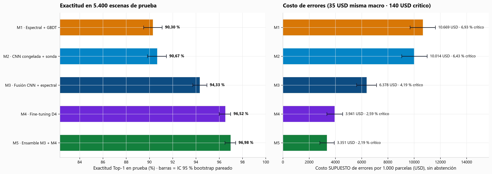 | 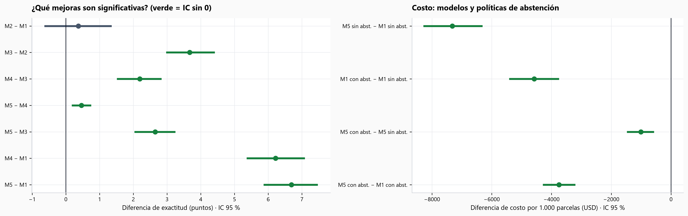 |

### ¿Qué diferencias son significativas? (bootstrap pareado, exactitud en puntos)

| Comparación | Diferencia | IC 95 % | ¿Significativa? |
| :--- | ---: | :---: | :---: |
| M2 − M1 (CNN congelada vs. índices) | +0,37 | [−0,61; +1,33] | **No** |
| M3 − M2 (añadir índices a la CNN congelada) | +3,67 | [+3,00; +4,39] | Sí |
| M4 − M3 (fine-tuning vs. fusión) | +2,19 | [+1,54; +2,81] | Sí |
| M5 − M4 (ensamble vs. fine-tuning solo) | +0,46 | [+0,20; +0,72] | Sí, pero pequeña |
| M5 − M1 | +6,69 | [+5,89; +7,44] | Sí |

**Lectura:**
- Con 16.200 imágenes de entrenamiento, una CNN de ImageNet **congelada** no supera de forma significativa a los 54 índices espectrales.
- La ganancia aparece al **combinar** ambos (M3) y, sobre todo, al **ajustar** la red (M4).
- El ensamble aporta medio punto: es estadísticamente distinto de cero, pero cuesta más del doble de latencia.

### Hallazgos clave

1. **La CNN gana en clases con forma, no en clases con color.** Del M1 al M5, el F1 sube:
   - de 73,24 % a **94,57 %** en Autopista (+21,33 pts);
   - de 84,47 % a **96,74 %** en Río (+12,27 pts);
   - de 84,92 % a **94,48 %** en Cultivo permanente (+9,56 pts).

   En Bosque (+0,92) y Mar/Lago (+1,16) los índices ya bastaban. Las confusiones que quedan en M5 son geométricas: 23 cultivos permanentes predichos como vegetación herbácea y 18 ríos como autopista. La confusión entre cultivo anual y permanente, que pide la ficha, se analiza más abajo.
2. **Pocas etiquetas → los rasgos preentrenados dominan.** Con **5 imágenes por clase**, el híbrido lineal (embeddings + índices) logra 69,17 % frente al 47,43 % del GBDT espectral (+21,7 pts). Con 25 por clase: 83,59 % frente a 75,56 %. Con 1.000 por clase la ventaja baja a 2,8 pts (92,74 % vs. 89,98 %).
3. **La abstención reduce el costo incluso con el mejor modelo** (siguiente sección).

| Curva Few-Shot (5 a 1.000 imágenes por clase) | F1 por clase: M1 vs. M5 |
| :---: | :---: |
| 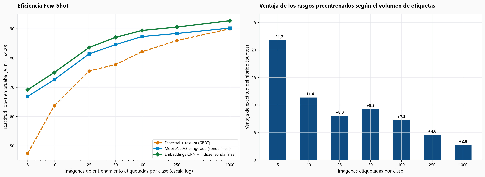 | 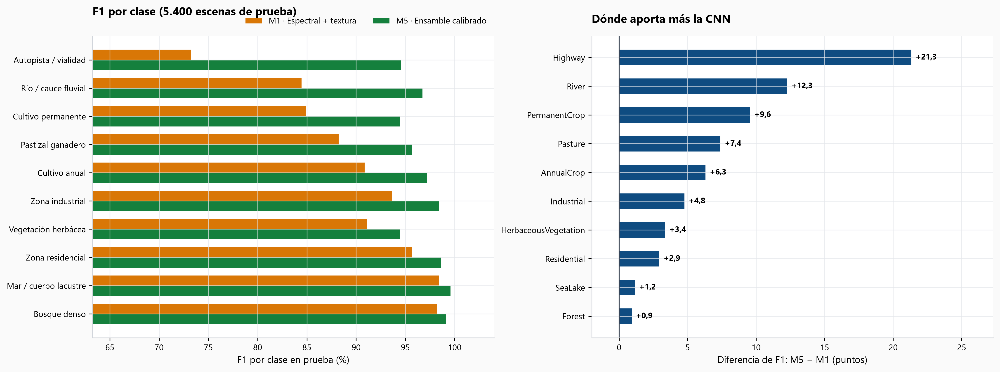 |

### Cultivo anual vs. cultivo permanente

Las dos son «Agrícola», así que confundirlas es un **error leve** (35 USD en la matriz de costos supuesta), y a simple vista en RGB son de las clases más parecidas: un campo arado o en barbecho y un olivar, un viñedo o un frutal comparten surcos y tonos verde-marrón. Conteos en la prueba (596 parcelas anuales + 538 permanentes = 1.134), tomados de `reports/matriz_confusion_espectral.csv` y `reports/matriz_confusion_mejor_modelo.csv`:

| Modelo | Anual → permanente | Permanente → anual | Se confunden entre sí (de 1.134) | Errores totales de las dos clases |
| :--- | ---: | ---: | ---: | ---: |
| M1 · índices espectrales | 10 | 16 | 26 (2,29 %) | 121 |
| **M5 · ensamble** | 2 | 8 | **10 (0,88 %)** | 55 |

- **La red reduce esta confusión un 62 %** (de 26 a 10), pero no es el error principal de ninguna de las dos clases. En cultivo permanente (la de menor *recall* del modelo, 92,19 %) el destino principal de los errores es la **vegetación herbácea** (23 de 42 errores, el 4,3 % de sus parcelas), no el cultivo anual (8). En cultivo anual, los 13 errores se reparten entre pastizal (5), vegetación herbácea (4), bosque (2) y cultivo permanente (2). La confusión entre ambas suma 10 de los 55 errores de M5 en estas dos clases.
- **Es asimétrica:** 8 de las 10 confusiones son permanente → anual. Es más común que el modelo llame «anual» a un permanente que al revés.
- **Casi todas se filtran con la abstención.** La confianza media de esas 10 predicciones es 71,7 %: 7 quedan por debajo de τ = 0,85 y van a revisión humana (7 × 18 = 126 USD). Las 3 que pasan como automáticas tienen confianza 0,90, 0,96 y 0,99 (3 × 35 = 105 USD). En total unos 231 USD de los 12.635 USD que cuesta toda la prueba (1,8 %).
- **Por qué (hipótesis, no medidas aquí):** la diferencia real entre una clase y otra es el **ciclo del cultivo** (el anual cambia con la temporada, el permanente mantiene cubierta todo el año), y una sola imagen RGB de 64×64 píxeles no lo ve. Probablemente ayudarían las bandas NIR y de borde rojo o una serie de fechas; no se probó.
- **Qué hacer según el uso:** si la decisión no necesita separarlas (por ejemplo, un inventario de «suelo agrícola»), fusionarlas elimina estos 10 errores; si la necesita (subsidios, impuestos), conviene un umbral de abstención más alto para este par o revisar esas parcelas con imágenes de otra época.

---

## 🎯 Calibración real y abstención con umbral elegido en validación

### Escalado por temperatura (T ajustada en validación, ECE medido en prueba)

| Modelo | T | ECE antes → después | Log-loss antes → después |
| :--- | ---: | :---: | :---: |
| M1 · GBDT espectral | 1,22 | 0,0273 → **0,0116** | 0,2780 → 0,2703 |
| M2 · sonda lineal | 1,91 | 0,0528 → **0,0077** | 0,3807 → 0,2883 |
| M3 · fusión MLP | 2,00 | 0,0347 → **0,0062** | 0,2330 → 0,1689 |
| M4 · fine-tuning | 0,72 | 0,0440 → **0,0061** | 0,1399 → 0,1072 |
| M5 · ensamble | 0,85 | 0,0445 → **0,0059** | 0,1251 → 0,0966 |

**Cómo se calibra:**
- Los modelos sklearn salen **sobreconfiados** (T > 1).
- La red fine-tuned sale **subconfiada** (T < 1) porque se entrenó con *label smoothing* 0,05.
- En M5 se calibran primero M3 y M4, se mezclan con el peso 0,75 / 0,25 que minimiza el log-loss en validación, y la mezcla recibe su propia temperatura.

### Comparación justa: con y sin abstención (τ elegido en validación para cada modelo)

Una parcela con confianza calibrada menor que τ va a un fotointérprete (18 USD). El resto se clasifica sola. La **exactitud en automáticas** solo cuenta las parcelas no derivadas; el **costo** incluye las revisiones.

| Política | τ (validación) | Automatizadas | Exactitud en automáticas | Errores críticos | Costo / 1.000 parcelas [IC 95 %] |
| :--- | ---: | ---: | ---: | ---: | ---: |
| M1 sin abstención | — | 100 % | 90,30 % | 374 | 10.668,52 USD [9.696; 11.621] |
| M1 con abstención | 0,85 | 78,96 % | 97,23 % | 79 | 6.087,59 USD [5.609; 6.556] |
| M5 sin abstención | — | 100 % | 96,98 % | 118 | 3.350,93 USD [2.813; 3.915] |
| **M5 con abstención** | **0,85** | **92,22 %** | **99,14 %** | **34** | **2.339,81 USD** [2.007; 2.676] |

**Lectura:**
- **M5 con abstención frente a M5 sin ella:** −1.011,11 USD por 1.000 parcelas, IC [−1.445; −600].
- **M5 frente a M1, ambos con abstención:** −3.747,78 USD, IC [−4.258; −3.232].

Ambas diferencias son significativas.

**Sobre el umbral elegido en validación:**
- Con τ = 0,85, la validación automatizaba el 92,11 % con un costo de 2.476,48 USD.
- En prueba el costo mínimo habría estado en τ = 0,80. Elegir τ en validación cuesta un poco de optimismo, pero no contamina la prueba.

### Sensibilidad a los costos supuestos (τ re-elegido en validación en cada escenario)

| Escenario | τ | Automatizadas | Costo M1 sin abst. | Costo M5 sin abst. | Costo M5 con abst. | Ahorro de la abstención |
| :--- | ---: | ---: | ---: | ---: | ---: | ---: |
| Base (18 / 35 / 140 USD) | 0,85 | 92,22 % | 10.668,52 | 3.350,93 | 2.339,81 | 30,2 % |
| Revisión a 9 USD | 0,90 | 89,98 % | 10.668,52 | 3.350,93 | 1.627,59 | 51,4 % |
| Revisión a 36 USD | 0,75 | 95,37 % | 10.668,52 | 3.350,93 | 3.176,85 | 5,2 % |
| Error leve a 17,5 USD | 0,85 | 92,22 % | 10.182,41 | 3.205,09 | 2.310,65 | 27,9 % |
| Error leve a 70 USD | 0,85 | 92,22 % | 11.640,74 | 3.642,59 | 2.398,15 | 34,2 % |
| Error crítico a 70 USD | 0,80 | 94,17 % | 5.820,37 | 1.821,30 | 1.685,19 | 7,5 % |
| Error crítico a 280 USD | 0,90 | 89,98 % | 20.364,81 | 6.410,19 | 3.203,33 | 50,0 % |

**Lectura:**
- En los 27 escenarios de `reports/sensibilidad_costos.csv` (cada costo ×0,5, ×1 o ×2), M5 con abstención cuesta entre un 68,4 % y un 89,0 % menos que M1 sin abstención.
- En cambio, el ahorro de la abstención **sobre M5** va de −0,5 % a 65,0 %: si la revisión humana es cara y los errores baratos, derivar deja de compensar.
- La decisión de abstenerse depende de los costos reales del cliente. La de usar M5 en lugar de M1, no.

---

## 🔍 Gráficos de diagnóstico

| Matrices de confusión (M1 vs. M5) | Calibración y costo según τ (validación vs. prueba) |
| :---: | :---: |
| 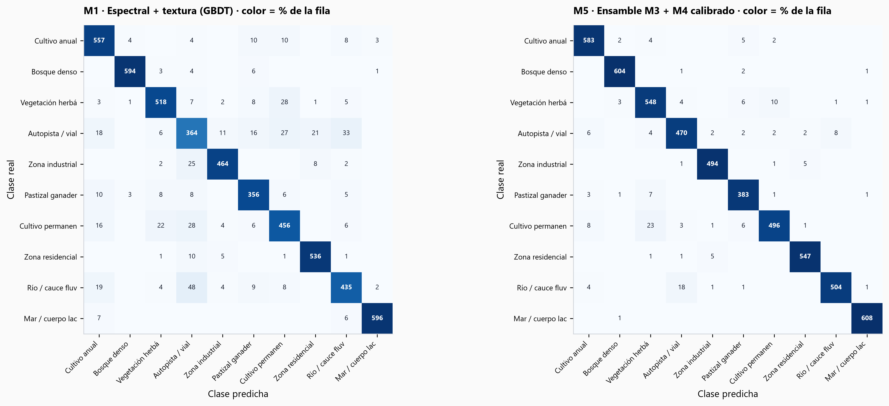 | 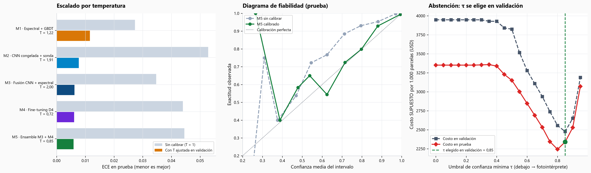 |
| **Robustez: velo simulado, ruido y desenfoque** | **Sensibilidad por oclusión (complemento de Grad-CAM)** |
| 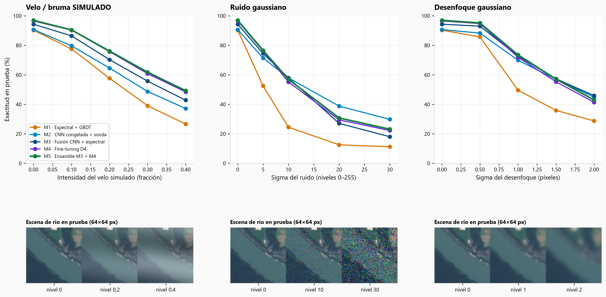 | 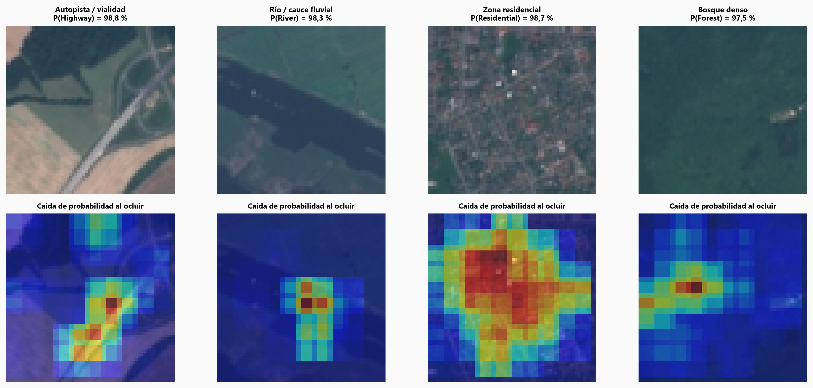 |

### Robustez de los 5 modelos (exactitud en prueba, %)

| Perturbación | M1 | M2 | M3 | M4 | M5 |
| :--- | ---: | ---: | ---: | ---: | ---: |
| Sin perturbar | 90,30 | 90,67 | 94,33 | 96,52 | 96,98 |
| Velo **simulado** 20 % | 57,61 | 64,56 | 70,26 | 75,69 | 76,09 |
| Ruido gaussiano σ = 10 | 24,48 | 57,93 | 57,93 | 55,19 | 56,98 |
| Ruido gaussiano σ = 20 | 12,52 | **38,76** | 27,04 | 29,44 | 30,74 |
| Desenfoque σ = 1 px | 49,59 | 69,94 | 72,70 | 72,02 | 73,57 |

**Lectura:**
- **Ningún modelo es robusto.** Todos se entrenaron con imágenes limpias, sin aumentos de ruido ni de desenfoque.
- El GBDT espectral es el más frágil: con σ = 10 cae al 24,48 %, porque los cuantiles y gradientes se disparan con el ruido.
- Con ruido fuerte, la CNN **congelada** (M2) resiste mejor que la fine-tuned: ajustar la red a imágenes limpias la volvió más sensible al ruido.
- El «velo» es una capa clara ondulada sintética, no nubosidad real de Sentinel-2. EuroSAT excluye escenas nubladas.
- Siguiente paso: entrenar con ruido y desenfoque como aumentos de datos.

### Grad-CAM: dónde mira la red (aciertos arriba, errores con alta confianza abajo)

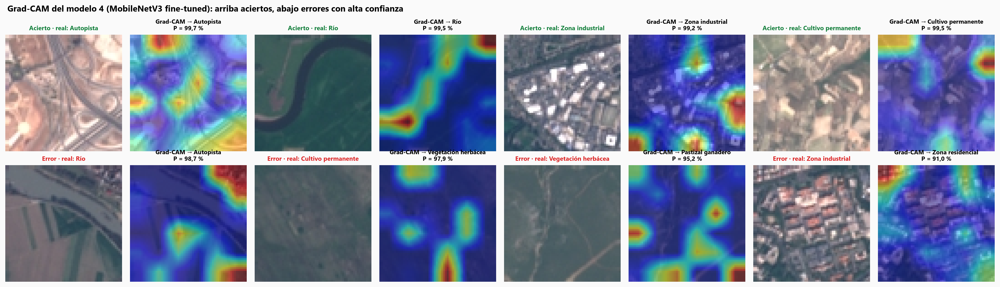

**Cómo se calcula:** Grad-CAM sobre el bloque `features[8]` de MobileNetV3 (rejilla de 6×6 con entrada de 96×96; el último bloque solo da 3×3).

**Qué muestra:**
- En los aciertos de autopista y río, el mapa se concentra en la vía y en el cauce.
- En los errores, la red mira bordes, texturas de cultivo o parches oscuros. Por ejemplo, un río con riberas agrícolas termina predicho como autopista con P = 98,7 %.

Los mapas de oclusión (figura 08) confirman lo mismo con otro método.

---

## ⚡ ONNX: mismas salidas, menor latencia en CPU

Se exportan dos grafos ONNX con el reescalado a 96×96 y la normalización **dentro** del grafo, así que la API infiere sin torch:
- `mobilenetv3_eurosat_finetuned.onnx` (4,32 MB): el M4.
- `mobilenetv3_imagenet_extractor.onnx` (3,72 MB): los embeddings de M3.

**Verificación:** en 512 imágenes de prueba, la diferencia máxima de logits frente a PyTorch es de **8,5·10⁻⁵** y la clase predicha coincide en el **100 %** de los casos. Las pruebas automatizadas lo comprueban otra vez con las 50 muestras y verifican que la API (ONNX) reproduce las probabilidades de M5 calculadas con PyTorch.

| Lote | PyTorch | ONNX Runtime | Aceleración |
| ---: | ---: | ---: | ---: |
| 1 imagen | 5,84 ms | **0,94 ms** | 6,2× |
| 64 imágenes | 0,62 ms/img | **0,26 ms/img** | 2,4× |

Mediana de 300 (lote 1) y 30 (lote 64) repeticiones, ambos motores con 4 hilos y solo para el M4.

---

## 🧠 Arquitectura del sistema

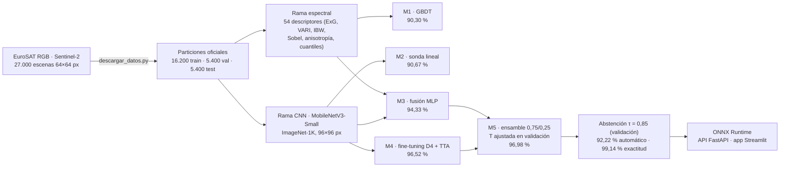

---

## 🔌 API REST (`api/main.py`) y app Streamlit (`app/app.py`)

```powershell
.\.venv\Scripts\uvicorn.exe api.main:app --reload            # API en http://localhost:8000/docs
.\.venv\Scripts\streamlit.exe run app/app.py --server.port 8616   # app
```

Petición a `POST /clasificar`:

```bash
curl -X POST http://localhost:8000/clasificar -H "Content-Type: application/json" -d '{"id_parcela": "CATASTRO_084", "archivo_muestra": "08_River_03.png"}'
```

Respuesta real del servicio (se omite el campo `probabilidades` con las 10 clases):

```json
{
  "id_parcela": "CATASTRO_084",
  "clase_predicha": "River",
  "nombre_es": "Río / cauce fluvial",
  "macro_categoria": "Cuerpo de agua",
  "confianza": 0.9284,
  "entropia_normalizada": 0.1154,
  "umbral_aplicado": 0.85,
  "decision_operativa": "CLASIFICACION_AUTOMATICA",
  "motivo_triaje": null,
  "top_3": [
    {"clase": "River", "nombre_es": "Río / cauce fluvial", "macro_categoria": "Cuerpo de agua", "probabilidad": 0.9284},
    {"clase": "Highway", "nombre_es": "Autopista / vialidad", "macro_categoria": "Infraestructura antrópica", "probabilidad": 0.0705},
    {"clase": "PermanentCrop", "nombre_es": "Cultivo permanente", "macro_categoria": "Agrícola", "probabilidad": 0.0003}
  ],
  "telemetria_espectral": {
    "exg_vegetacion": 0.0236, "vari_vegetacion": 0.3613, "indice_agua": 0.1965,
    "brillo": 0.3251, "contraste": 0.0705, "rugosidad_espacial": 0.0171,
    "alerta_velo_atmosferico": false
  }
}
```

La app permite subir un parche o elegir una de las 50 muestras de prueba. Muestra la clase, la confianza calibrada, la decisión (automática o revisión humana) y las probabilidades por clase, junto con el Grad-CAM para la clase predicha:

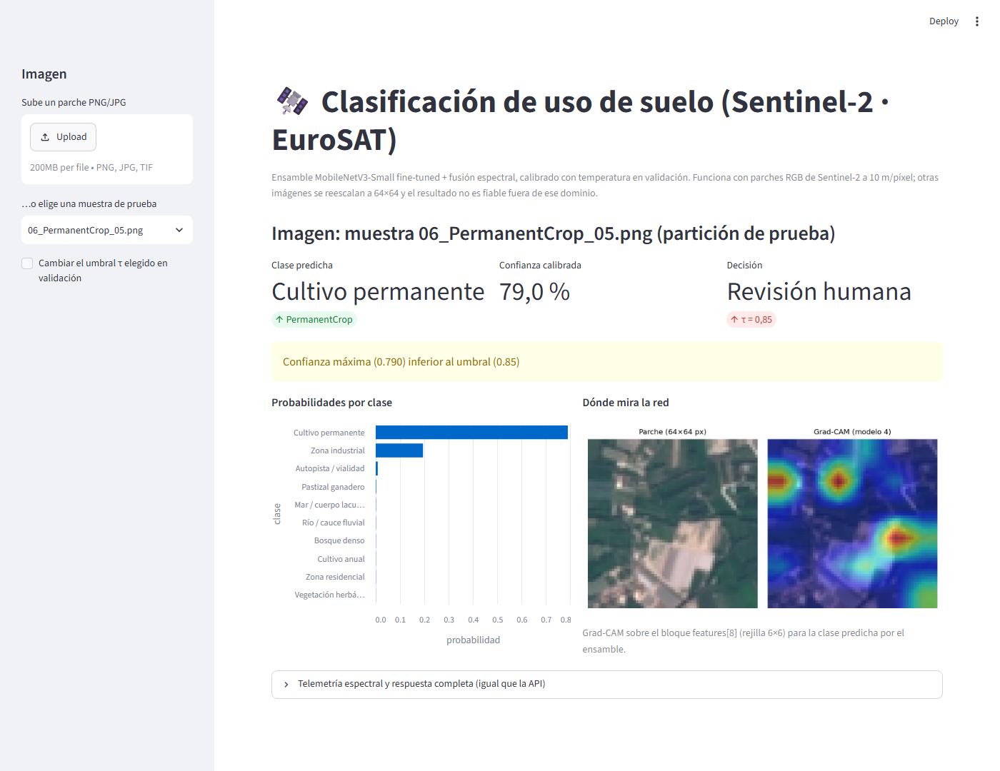

**Modelos versionados:** `models/` pesa unos 17 MB:
- `clasificador_eurosat.joblib` (4,5 MB);
- `mobilenetv3_eurosat_finetuned.pt` (4,4 MB, para el Grad-CAM);
- los dos ONNX.

La API y la app funcionan en un clon recién descargado. Si falta un archivo, la API responde **503** con la instrucción para regenerarlo, y `predecir.py` lanza `ArtefactoNoEncontrado`. Nunca cae en silencio a un modelo peor.

---

## 🛰️ Auditoría de las 27.000 escenas y F1 por clase

| ID | Clase | Nombre | Macro-categoría | Escenas | Prueba | ExG medio | Índice (B−R)/(B+R) | Rugosidad | F1 M1 | F1 M5 | Δ pts |
| :-: | :--- | :--- | :--- | ---: | ---: | ---: | ---: | ---: | ---: | ---: | ---: |
| 0 | `AnnualCrop` | Cultivo anual | Agrícola | 3.000 | 596 | −0,0101 | −0,0280 | 0,0144 | 90,86 % | **97,17 %** | +6,31 |
| 1 | `Forest` | Bosque denso | Ecosistema natural | 3.000 | 608 | +0,0753 | +0,3198 | 0,0077 | 98,18 % | **99,10 %** | +0,92 |
| 2 | `HerbaceousVegetation` | Vegetación herbácea | Ecosistema natural | 3.000 | 573 | −0,0113 | +0,0474 | 0,0207 | 91,12 % | **94,48 %** | +3,36 |
| 3 | `Highway` | Autopista / vialidad | Infraestructura antrópica | 2.500 | 496 | +0,0145 | +0,1083 | 0,0247 | 73,24 % | **94,57 %** | +21,33 |
| 4 | `Industrial` | Zona industrial | Infraestructura antrópica | 2.500 | 501 | −0,0173 | +0,0501 | 0,0522 | 93,64 % | **98,41 %** | +4,77 |
| 5 | `Pasture` | Pastizal ganadero | Agrícola | 2.000 | 396 | +0,0931 | +0,2080 | 0,0108 | 88,23 % | **95,63 %** | +7,40 |
| 6 | `PermanentCrop` | Cultivo permanente | Agrícola | 2.500 | 538 | −0,0073 | −0,0164 | 0,0268 | 84,92 % | **94,48 %** | +9,56 |
| 7 | `Residential` | Zona residencial | Infraestructura antrópica | 3.000 | 554 | −0,0148 | +0,0754 | 0,0436 | 95,71 % | **98,65 %** | +2,94 |
| 8 | `River` | Río / cauce fluvial | Cuerpo de agua | 2.500 | 529 | +0,0406 | +0,1947 | 0,0171 | 84,47 % | **96,74 %** | +12,27 |
| 9 | `SeaLake` | Mar / cuerpo lacustre | Cuerpo de agua | 3.000 | 609 | +0,0264 | +0,3365 | 0,0032 | 98,43 % | **99,59 %** | +1,16 |

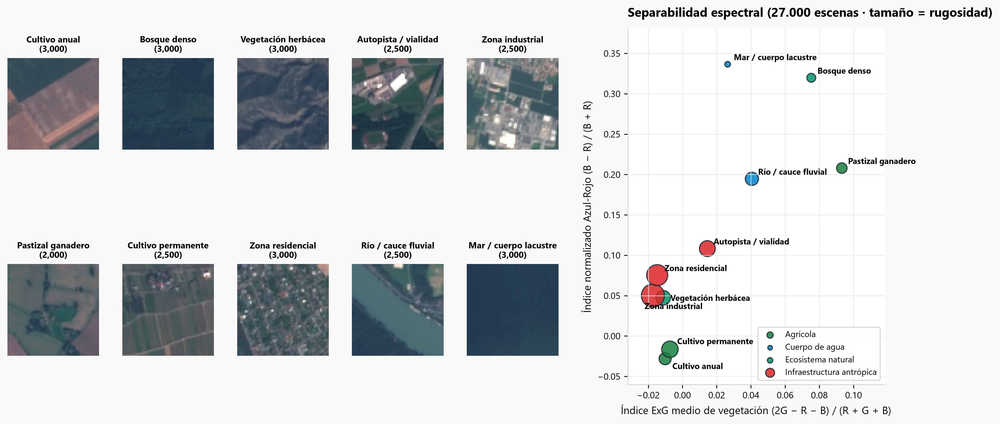

---

## 🚀 Cómo reproducir

```powershell
# 1. Entorno (CPU)
py -3.14 -m venv .venv
.\.venv\Scripts\pip.exe install -r requirements.txt
.\.venv\Scripts\pip.exe install -e .

# 2. Descargar las 27.000 imágenes oficiales (≈90 MB de Parquet) y preparar las particiones
.\.venv\Scripts\python.exe descargar_datos.py

# 3. Entrenar, calibrar, evaluar con bootstrap, exportar ONNX y escribir reports/ (≈11 min en CPU)
.\.venv\Scripts\python.exe -m eurosat_suelo.entrenar

# 4. Figuras y notebooks
.\.venv\Scripts\python.exe -m eurosat_suelo.graficos
.\.venv\Scripts\python.exe scripts\generar_notebooks.py

# 5. Pruebas (incluyen ONNX = PyTorch, Grad-CAM y cifras del README contra reports/)
.\.venv\Scripts\pytest.exe -q
```

Las cifras publicadas son las del Ryzen 5 4600G. Con la misma semilla, otra CPU puede mover la exactitud de las redes en torno a 0,2 puntos, porque PyTorch no da resultados idénticos bit a bit entre procesadores; el modelo espectral (M1) sale igual. Si reentrenas en otro equipo, `tests/test_readme_cifras.py` avisa que el README ya no coincide con tu `reports/`: es el aviso esperado, no un error del pipeline.

**Limitaciones:**
- Solo bandas visibles (RGB): sin NIR ni borde rojo, que separarían mejor cultivos y vegetación.
- EuroSAT es europeo. En Ecuador habría que reajustar con escenas locales; la curva Few-Shot sugiere que 25–100 por clase ya ayudan.
- Los costos son ilustrativos.
- El umbral τ se elige en validación (0,85); en prueba el costo mínimo habría estado en τ = 0,80. Esa diferencia es el pequeño optimismo de ajustar en una partición y reportar en otra.
- Cultivo anual y permanente se confunden en 10 de 1.134 parcelas (0,88 %), sobre todo permanente → anual (ver el análisis arriba).

Detalle en [`MODEL_CARD.md`](MODEL_CARD.md) y [`docs/GUIA_PASO_A_PASO.md`](docs/GUIA_PASO_A_PASO.md).

## 📜 Fuente de datos y licencia
* **Dataset:** Helber, Bischke, Dengel y Borth (2019), *EuroSAT: A Novel Dataset and Deep Learning Benchmark for Land Use and Land Cover Classification*, IEEE JSTARS. Imágenes Copernicus Sentinel-2 de acceso abierto.
* **Espejo usado:** [`huggingface.co/datasets/timm/eurosat-rgb`](https://huggingface.co/datasets/timm/eurosat-rgb) (particiones oficiales train/validation/test).
* **Licencia:** el **código** es MIT (ver [LICENSE](LICENSE)). Los **datos** (EuroSAT e imágenes Copernicus Sentinel-2) siguen su propia licencia, no la del código; las 50 imágenes de `data/muestra_eurosat/` se incluyen solo como ejemplo.
