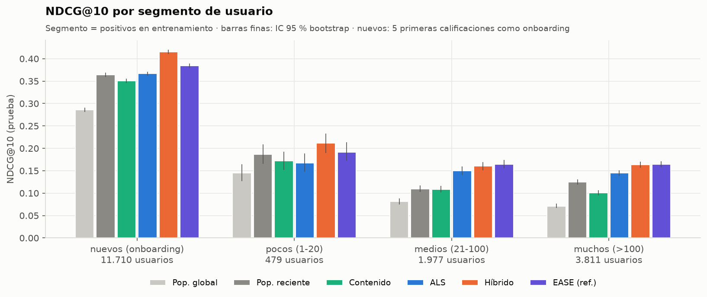
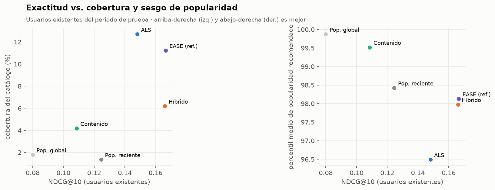
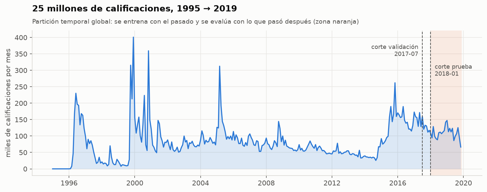
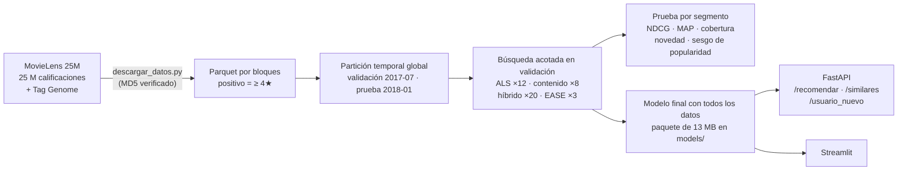
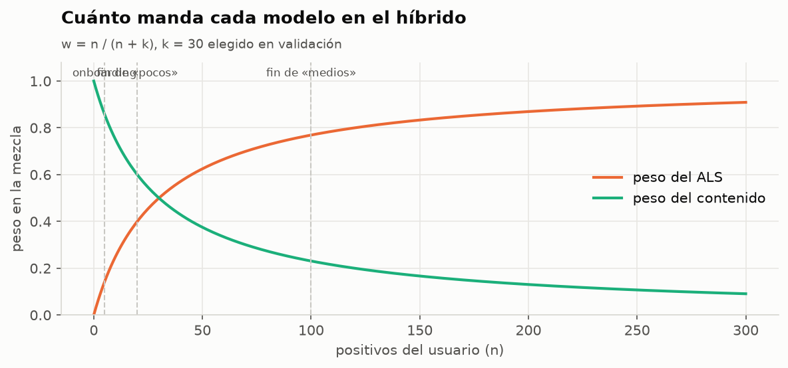
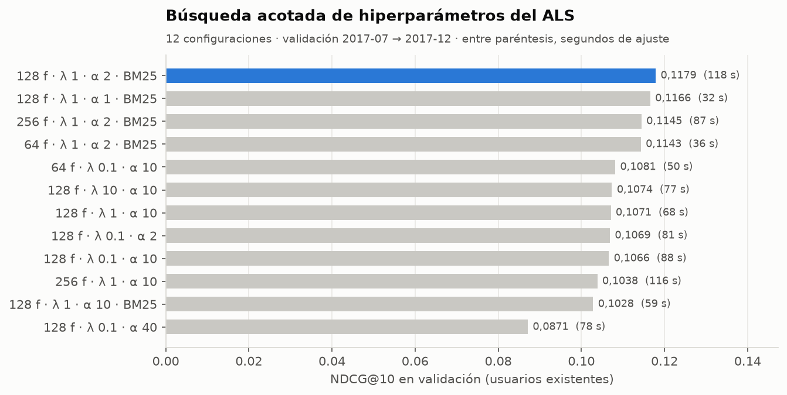
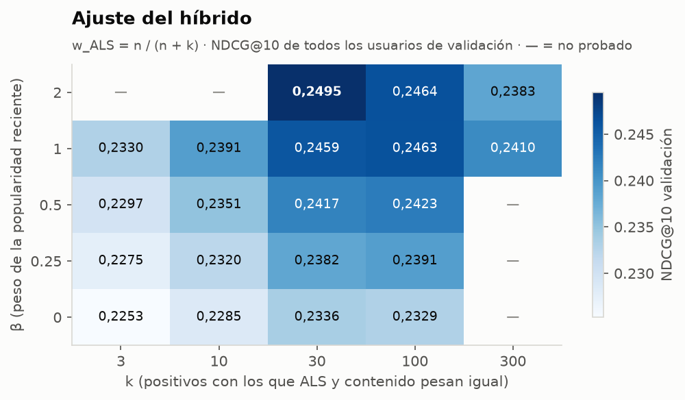

# 🎬 ¿Qué película ver ahora? Recomendador sobre MovieLens 25M

Sistema de recomendación de películas entrenado con **25 millones de calificaciones** de 162 mil usuarios (MovieLens 25M, 1995 → 2019). Combina **filtrado colaborativo implícito (ALS)**, un **modelo de contenido** con géneros y el **Tag Genome** (1.128 etiquetas por película) y la **popularidad reciente** en un híbrido que se adapta a cuánta historia tiene cada usuario. Se evalúa como en la vida real, con una **partición temporal global** (entrenar con el pasado, predecir lo que cada usuario vio después) y **por segmento de usuario**, incluidos los **usuarios nuevos** (arranque en frío). Incluye **API FastAPI**, **app Streamlit**, 3 notebooks ejecutados y ficha del modelo.


---

## 📌 El problema

Un catálogo de ~20 mil películas y cada usuario ha visto unas pocas decenas. La pregunta no es «¿qué nota le pondría a *Titanic*?» (el RMSE del premio Netflix), sino **«¿qué 10 películas le muestro hoy para que vea una y le guste?»**. Eso obliga a:

1. **Ordenar, no puntuar:** métricas de ranking top-K (Precision, Recall, NDCG y MAP @10).
2. **No mirar el futuro:** la partición aleatoria (y hasta *leave-last-one* por usuario) entrena con datos posteriores al momento que se quiere predecir.
3. **Servir a quien no tiene historia:** usuarios nuevos que solo marcaron géneros o calificaron 5 películas.
4. **No recomendar solo éxitos:** medir cobertura del catálogo, novedad, diversidad y sesgo de popularidad.

## 🏆 Resultados (prueba: entrenar < 2018-01-01, evaluar 2018-01 → 2019-11)

Relevante = película que el usuario calificó con ≥ 4★ después del corte y que no había visto. Top-10. Entre corchetes, IC 95 % bootstrap.

**Usuarios existentes** (6.267 que tenían historia y volvieron después del corte):

| Modelo | Precision@10 | Recall@10 | **NDCG@10** | MAP@10 | Cobertura | Novedad |
|---|---:|---:|---:|---:|---:|---:|
| Popularidad global | 0,067 | 0,031 | 0,080 | 0,042 | 1,8 % | 2,1 bits |
| Popularidad reciente (180 días) | 0,106 | 0,057 | 0,125 | 0,066 | 1,4 % | 3,2 bits |
| Contenido (géneros + genome) | 0,094 | 0,045 | 0,109 | 0,057 | 4,2 % | 2,7 bits |
| ALS implícito | 0,127 | 0,060 | 0,148 | 0,082 | **12,7 %** | **4,7 bits** |
| **Híbrido (ALS + contenido + recientes)** | **0,142** | **0,072** | **0,166** [0,161–0,171] | 0,092 | 6,2 % | 3,9 bits |
| EASE (referencia, no va a la API) | 0,141 | 0,070 | 0,167 [0,161–0,172] | **0,095** | 11,2 % | 3,7 bits |

**Por segmento** (NDCG@10; segmento = positivos del usuario antes del corte):

| Modelo | Nuevos (onboarding de 5) | Pocos (1-20) | Medios (21-100) | Muchos (>100) |
|---|---:|---:|---:|---:|
| Usuarios | 11.710 | 479 | 1.977 | 3.811 |
| Popularidad global | 0,286 | 0,145 | 0,081 | 0,071 |
| Popularidad reciente | 0,364 | 0,186 | 0,110 | 0,124 |
| Contenido | 0,350 | 0,172 | 0,109 | 0,101 |
| Solo géneros elegidos (sin películas) | 0,225 | — | — | — |
| ALS (fold-in para nuevos) | 0,367 | 0,168 | 0,150 | 0,145 |
| **Híbrido** | **0,415** | **0,211** | 0,160 | 0,163 |
| EASE (referencia) | 0,385 | 0,191 | **0,165** | **0,164** |



👉 **El híbrido es el mejor modelo servible en todos los segmentos**. Frente al ALS solo, la mejora (bootstrap pareado por usuario) es **+0,049 NDCG en usuarios nuevos** [+0,046; +0,051], **+0,044 en «pocos»** [+0,031; +0,058], +0,010 en «medios» [+0,006; +0,014] y +0,019 en «muchos» [+0,016; +0,022]. Empata con EASE en usuarios existentes y le gana con claridad en arranque en frío, sin necesitar una matriz película × película de 1 GB. Los intervalos de las 12 comparaciones (híbrido contra ALS, popularidad reciente y contenido, por segmento) están en [`reports/bootstrap_pareado.csv`](reports/bootstrap_pareado.csv).

**La lectura honesta:**
- **La popularidad reciente es una línea base dura** en una partición temporal: le gana al contenido y en «pocos» al ALS, porque la gente ve estrenos. Por eso el híbrido la incluye con un peso β elegido en validación.
- **Exactitud vs. descubrimiento:** el ALS cubre el 12,7 % del catálogo y el híbrido el 6,2 %. El híbrido gana NDCG empujando hacia lo popular (percentil de popularidad medio 98,0 frente a 96,5 del ALS). Si el negocio quiere más descubrimiento, basta bajar β.



## ⏳ ¿Por qué la partición temporal global?

| Partición | Qué se esconde | Problema |
|---|---|---|
| Aleatoria 80/20 | calificaciones al azar | entrena con 2019 para «predecir» 2005 |
| *Leave-last-one* por usuario | la última de cada usuario | cada usuario tiene su reloj: **en promedio el 53,8 % del entrenamiento ocurre después** del momento que se predice (medido en el [notebook 1](notebooks/01_datos_y_particion_temporal.ipynb)) |
| **Corte global por fecha** (este proyecto) | todo lo posterior al corte, para todos | ninguno: es lo que pasa en producción |



- **Validación:** entrenar < 2017-07-01, evaluar 2017-07 → 2017-12. Aquí se eligen **todos** los hiperparámetros.
- **Prueba:** entrenar < 2018-01-01 (22,5 M calificaciones, 11,2 M positivos, 150.543 usuarios, 17.102 películas recomendables), evaluar 2018-01 → 2019-11, **una sola vez**.
- **Usuarios nuevos:** aparecen después del corte. Sus **5 primeras calificaciones** hacen de cuestionario de bienvenida (como el onboarding real de MovieLens) y se evalúa con el resto.
- La ventana de prueba es larga (23 meses) porque **pocos usuarios vuelven**: con 6 meses solo quedaban 271 usuarios en el segmento «pocos».

## 🧠 Cómo funciona



| Modelo | Cómo | Hiperparámetros elegidos (validación) |
|---|---|---|
| Popularidad global / reciente | conteo de positivos (todo / últimos 180 días) | — |
| **ALS implícito** (`implicit`) | factorización con confianza α, pesos BM25; usuarios nuevos por *fold-in* (un paso de mínimos cuadrados con las películas fijas, milisegundos) | 128 factores, λ = 1, α = 2, BM25 |
| **Contenido** | película = [Tag Genome reducido con SVD a 64 dims (72,8 % de la varianza) · géneros]; perfil = promedio de lo que le gustó; + prior de popularidad | peso de géneros 0,2, popularidad 0,3 |
| **Híbrido** | `w·z(ALS) + (1−w)·z(contenido) + β·z(recientes)`, con `w = n/(n+k)` | k = 30, β = 2 |
| EASE (referencia) | autoencoder lineal item-item de forma cerrada (Steck 2019) | λ = 1.000 |



Con k = 30, el ALS pesa 12 % para un usuario nuevo con 5 películas (mediana), 30 % en «pocos», 66 % en «medios» y 88 % en «muchos».

| Decisión | Por qué |
|---|---|
| **Señal implícita (≥ 4★)** en vez de predecir la nota | el objetivo es ordenar lo que va a ver y disfrutar; es la señal que tiene la mayoría de las empresas (reproducciones, compras) |
| **Corte temporal global** | evita el 53,8 % de «futuro» que se cuela con *leave-last-one* |
| **Búsqueda acotada** (43 configuraciones, no la rejilla completa) | cada ALS cuesta 0,5-2 min; cada resultado se guarda al terminar y el pipeline reanuda si se corta |
| **BM25 sobre los positivos** | baja el peso de los éxitos que ve todo el mundo: +0,010 NDCG frente al mejor ALS sin BM25 (0,118 vs. 0,108) |
| **IDF de BM25 del entrenamiento en el fold-in** | calcularlo con el lote evaluado da pesos distintos para el mismo usuario (hay una prueba automática) |
| **`threadpoolctl` al ajustar ALS** | BLAS y los hilos de `implicit` compitiendo: 16 min → 0,5-2 min por ajuste |
| **EASE solo como referencia** | B es 17 mil × 17 mil (1,2 GB); no escala a catálogos grandes ni cabe en el paquete de la API |
| **Paquete liviano para servir** (13 MB) | factores de películas, vectores de contenido, popularidad y 1.500 usuarios de demostración; cualquier otro usuario se atiende por fold-in |

Ajuste del híbrido y búsqueda del ALS:

| | |
|---|---|
|  |  |

El mejor β (2) quedó en el borde de la rejilla ampliada, con retorno decreciente (+0,004 de β = 1 a β = 2). Se dejó así a propósito para no sobreajustar la validación.

## 🧊 Arranque en frío

| ¿Qué sabemos del usuario nuevo? | Método | NDCG@10 (11.710 nuevos) |
|---|---|---:|
| Nada | popularidad reciente | 0,364 |
| Solo 2-3 géneros favoritos | contenido por géneros + popularidad | 0,225 |
| 5 calificaciones (las que le gustaron) | ALS por fold-in | 0,367 |
| 5 calificaciones | **híbrido** (88 % contenido + recientes) | **0,415** |

**Conclusión:** pedir **5 películas** en el registro vale mucho más que pedir géneros. Con solo géneros, mostrar lo popular reciente es mejor. La API expone las tres vías.

## 📏 Más allá de la exactitud (usuarios existentes)

| Modelo | Cobertura | Novedad (bits) | Diversidad de géneros | Percentil de popularidad | Δ popularidad vs. su historial |
|---|---:|---:|---:|---:|---:|
| Popularidad global | 1,8 % | 2,09 | 0,71 | 99,9 | +8,0 |
| Popularidad reciente | 1,4 % | 3,19 | 0,69 | 98,4 | +6,6 |
| Contenido | 4,2 % | 2,71 | 0,54 | 99,5 | +7,7 |
| ALS | **12,7 %** | **4,65** | 0,64 | **96,5** | **+4,7** |
| Híbrido | 6,2 % | 3,88 | 0,67 | 98,0 | +6,1 |
| EASE | 11,2 % | 3,74 | 0,68 | 98,1 | +6,3 |

Todos los modelos recomiendan películas más populares que las que el usuario ya ve (Δ > 0): es el **sesgo de popularidad** clásico. El 20 % más popular del catálogo concentra la gran mayoría de los positivos ([figura](reports/figures/06_cola_larga.png)). El contenido es el **menos diverso** (recomienda «más de lo mismo»), y el ALS el que más descubre.

## 🔌 API

```bash
uvicorn api.main:app --reload          # documentación interactiva en http://localhost:8000/docs
```

| Endpoint | Qué hace |
|---|---|
| `GET /recomendar/{usuario}?n=10&metodo=hibrido` | top-N para un usuario del paquete de demostración, sin lo ya visto; incluye segmento, peso del ALS y «porque te gustó…» |
| `POST /recomendar` | cualquier usuario a partir de las películas que le gustaron (fold-in, sin re-entrenar) |
| `POST /usuario_nuevo` | arranque en frío solo con géneros (acepta español: «ciencia ficción», «Terror») |
| `GET /similares/{pelicula}?metodo=hibrido\|als\|contenido` | películas parecidas por ADN de etiquetas, por co-consumo o mezcla |
| `GET /buscar?q=matrix` · `GET /usuarios_demo` · `GET /generos` · `GET /modelo` · `GET /salud` | utilidades |

```bash
curl -X POST "http://localhost:8000/recomendar?n=5" -H "Content-Type: application/json" \
     -d '{"le_gustaron": [1, 3114, 2355, 4886]}'
```

```json
{"metodo": "hibrido", "positivos_en_historial": 4, "peso_als": 0.118, "recomendaciones": [
  {"movieId": 6377, "titulo": "Finding Nemo (2003)", "generos": ["Adventure", "Animation", "Children", "Comedy"], "porque_te_gusto": "Bug's Life, A (1998)"},
  {"movieId": 4306, "titulo": "Shrek (2001)", "porque_te_gusto": "Monsters, Inc. (2001)"},
  {"movieId": 8961, "titulo": "Incredibles, The (2004)", "porque_te_gusto": "Monsters, Inc. (2001)"}, "…"]}
```

*Similares a The Matrix:* por **contenido** → The Terminator, Equilibrium, Blade Runner; por **ALS** → Fight Club, Inception, Matrix Reloaded. Son dos ideas distintas de «parecido», y el híbrido mezcla ambas.

## 🖥️ App

```bash
streamlit run app/app.py --server.port 8611
```

Cuatro pestañas: usuario existente (con explicación «porque te gustó…»), usuario nuevo (por géneros o eligiendo películas con un buscador), películas similares y resultados de la evaluación.

## 📓 Notebooks (ejecutados, con resultados)

1. [Datos y partición temporal](notebooks/01_datos_y_particion_temporal.ipynb): señal implícita, cuánto futuro filtra *leave-last-one*, segmentos, cola larga, Tag Genome
2. [Modelos y búsqueda](notebooks/02_modelos_y_busqueda.ipynb): rejillas de ALS, contenido, híbrido y EASE; similitud por contenido vs. colaborativa; fold-in en milisegundos
3. [Evaluación por segmento y API](notebooks/03_evaluacion_por_segmento_y_api.ipynb): métricas por segmento, bootstrap pareado, más allá de la exactitud, arranque en frío, uso de la API

## 🚀 Cómo ejecutarlo

Guía detallada para Windows y preguntas de entrevista: **[docs/GUIA_PASO_A_PASO.md](docs/GUIA_PASO_A_PASO.md)** · Ficha del modelo: **[MODEL_CARD.md](MODEL_CARD.md)**

```bash
python -m venv .venv && .venv\Scripts\activate
pip install -r requirements.txt
python descargar_datos.py                # 262 MB desde GroupLens → data/raw/ (1,2 GB)
python generar_demo.py                   # ~2 min: crea los 3 archivos de models/ que llevan datos de MovieLens
pytest                                   # pruebas (las de la API se omiten si faltan esos 3 archivos)
uvicorn api.main:app --reload            # API
streamlit run app/app.py                 # app
python -m recomendador.entrenar          # (opcional) búsqueda + prueba + modelo final: ~1 h la primera vez
```

El modelo entrenado viene en `models/` (12 MB: factores, vectores de contenido, usuarios de demostración y metadata). **Tres archivos de ese paquete no se suben al repositorio** porque contienen datos de MovieLens, cuya licencia no permite redistribuirlos: `peliculas.parquet` (títulos y géneros), `demo_positivos.npz` y `demo_vistos.npz` (qué películas calificó cada usuario de demostración). `python generar_demo.py` los reconstruye, idénticos, a partir de los datos descargados del sitio oficial. Si faltan, la API responde `503` con ese mismo mensaje y la app lo muestra en pantalla. Recursos: pico de RAM de ~3 GB (EASE), CPU de 6 núcleos compartida, sin GPU.

## 📁 Estructura

```
├── descargar_datos.py     baja ml-25m.zip de GroupLens, verifica MD5 y descomprime en data/raw/
├── generar_demo.py        crea en models/ los 3 archivos con datos de MovieLens (no se redistribuyen)
├── src/recomendador/
│   ├── config.py          rutas, cortes temporales, umbral de positivo, segmentos
│   ├── datos.py           CSV → Parquet por bloques, películas, genome, partición temporal y matrices CSR
│   ├── modelos.py         popularidad, ALS (fold-in, BM25), EASE, contenido, híbrido, solo géneros, top-K
│   ├── metricas.py        P/R/NDCG/AP@K, cobertura, novedad, diversidad, sesgo de popularidad, bootstrap
│   ├── evaluacion.py      evaluación por lotes de existentes y nuevos, resumen por segmento
│   ├── busqueda.py        búsqueda acotada y reanudable en validación
│   ├── entrenar.py        pipeline completo en un comando
│   ├── demo.py            genera/valida los archivos de models/ con datos de MovieLens
│   ├── graficos.py        7 figuras
│   └── servicio.py        recomendador servible (lo usan la API y la app)
├── api/main.py            FastAPI
├── app/app.py             Streamlit
├── models/                paquete liviano (12 MB versionados): factores, vectores, usuarios demo, metadata; el resto se genera
├── notebooks/             3 notebooks ejecutados
├── reports/               búsquedas, métricas de prueba (por segmento y por usuario), IC del bootstrap pareado, figuras
├── tests/                 43 pruebas: métricas a mano, partición sin fuga, modelos con datos sintéticos, paquete incompleto, API
└── MODEL_CARD.md          ficha del modelo
```

## 📚 Fuente de datos

**MovieLens 25M** — GroupLens Research, Universidad de Minnesota: <https://grouplens.org/datasets/movielens/25m/> · archivo <https://files.grouplens.org/datasets/movielens/ml-25m.zip>. 25.000.095 calificaciones y 1.093.360 etiquetas de 162.541 usuarios sobre 62.423 películas (59.047 con calificaciones), enero 1995 – noviembre 2019, más el Tag Genome (15,6 M puntajes de relevancia de 1.128 etiquetas para 13.816 películas).

**Licencia:** el **código** de este repositorio es MIT (ver [LICENSE](LICENSE)). Los **datos** siguen su propia licencia: según el [README oficial](https://files.grouplens.org/datasets/movielens/ml-25m-README.html) de MovieLens, se permite el uso para investigación y educación, sin fines comerciales, citando la fuente; **no se puede redistribuir** el dataset. Por eso los datos no se versionan, `descargar_datos.py` los baja del sitio oficial, y los tres archivos de `models/` que contienen títulos o calificaciones (`peliculas.parquet`, `demo_positivos.npz`, `demo_vistos.npz`) tampoco se suben y se generan con `python generar_demo.py`. Lo que sí se versiona son parámetros del modelo (factores de películas y de 1.500 usuarios anónimos identificados solo por un número) y métricas agregadas.

Cita: F. Maxwell Harper y Joseph A. Konstan (2015). *The MovieLens Datasets: History and Context.* ACM Transactions on Interactive Intelligent Systems 5(4): 19. DOI [10.1145/2827872](https://doi.org/10.1145/2827872).

Referencias de los métodos: Hu, Koren y Volinsky (2008), *Collaborative Filtering for Implicit Feedback Datasets* · Steck (2019), *Embarrassingly Shallow Autoencoders for Sparse Data* · Vig, Sen y Riedl (2012), *The Tag Genome* · Ji et al. (2023), *A Critical Study on Data Leakage in Recommender System Offline Evaluation*.

---

**Erick Guarnizo** · proyecto de portafolio (Machine Learning)
